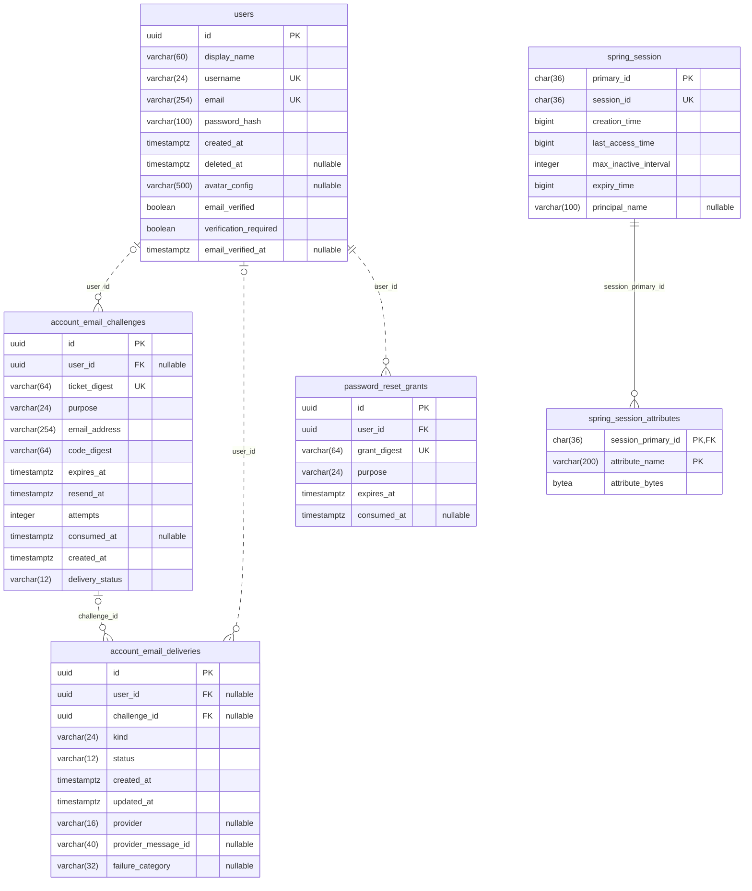
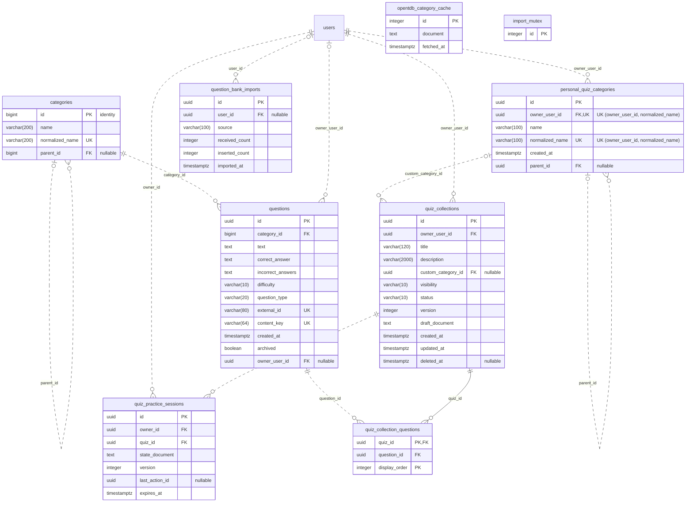
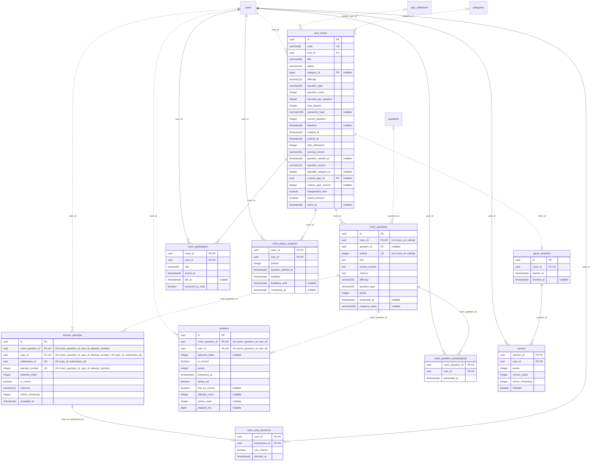
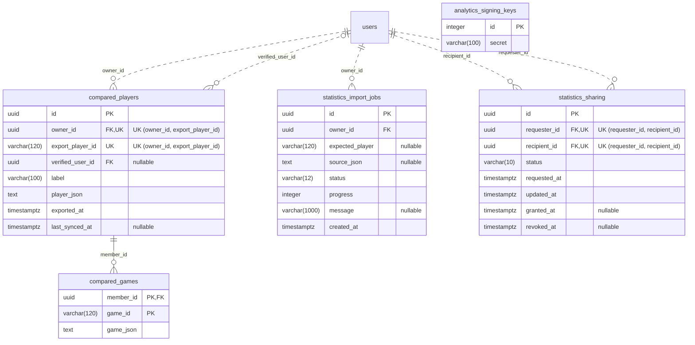
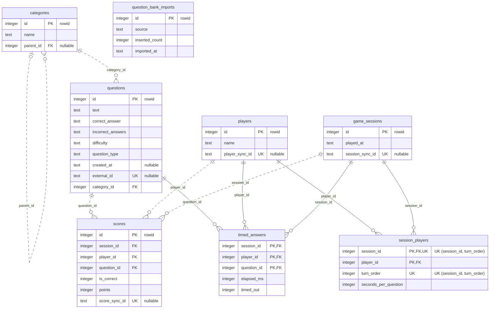

# Entity-Relationship Diagrams

## Reading the diagrams

PK identifies a primary key, FK identifies a foreign key, and UK identifies a unique key or unique index. When a key spans multiple columns, the key table lists them together. A UK marker on one part of a composite key does not imply single-column uniqueness. The diagrams mark columns that can be null. Dashed relationships are non-identifying, and solid relationships use the parent key as part of the child’s primary key. Some tables appear as reference boxes in more than one diagram.

## PostgreSQL for Hootly Online

The tables below were read from a disposable PostgreSQL 17 database after Flyway applied V1 through V16. Types such as `varchar(n)` and `timestamptz` are PostgreSQL aliases. Flyway maintains a separate schema-history table. The [SQL migrations](../online/backend/src/main/resources/db/migration/) and [Java migrations](../online/backend/src/main/java/db/migration/) define the full constraints and defaults.

### Accounts and email

Accounts use unique usernames and email addresses. Display names can repeat. Spring Session stores its attributes in a separate table with a composite PK and cascades their deletion when the session is deleted.

| Table | PK | UK, including unique indexes | FK columns and targets |
|---|---|---|---|
| `users` | `(id)` | `(email)` `(username)` | — |
| `account_email_challenges` | `(id)` | `(ticket_digest)` | `(user_id) → users(id)` |
| `password_reset_grants` | `(id)` | `(grant_digest)` | `(user_id) → users(id)` |
| `account_email_deliveries` | `(id)` | — | `(challenge_id) → account_email_challenges(id)` `(user_id) → users(id)` |
| `spring_session` | `(primary_id)` | `(session_id)` | — |
| `spring_session_attributes` | `(session_primary_id, attribute_name)` | — | `(session_primary_id) → spring_session(primary_id) ON DELETE CASCADE` |

### Quizzes and question sources

A quiz collection orders its questions through `quiz_collection_questions`. A question can be shared by multiple collections belonging to its owner. Personal categories support nesting. Their unique key is `(owner_user_id, normalized_name)`. It rejects repeated names within one branch and across separate branches owned by the same account. Different owners can use the same name. The OpenTDB category cache holds category metadata. The old shared-bank import table retains its records.

| Table | PK | UK, including unique indexes | FK columns and targets |
|---|---|---|---|
| `categories` | `(id)` | `(normalized_name)` | `(parent_id) → categories(id)` |
| `personal_quiz_categories` | `(id)` | `(owner_user_id, normalized_name)` | `(owner_user_id) → users(id)` `(parent_id) → personal_quiz_categories(id)` |
| `questions` | `(id)` | `(content_key)` `(external_id)` | `(category_id) → categories(id)` `(owner_user_id) → users(id)` |
| `quiz_collections` | `(id)` | — | `(custom_category_id) → personal_quiz_categories(id)` `(owner_user_id) → users(id)` |
| `quiz_collection_questions` | `(quiz_id, display_order)` | — | `(question_id) → questions(id)` `(quiz_id) → quiz_collections(id)` |
| `quiz_practice_sessions` | `(id)` | — | `(owner_id) → users(id)` `(quiz_id) → quiz_collections(id)` |
| `opentdb_category_cache` | `(id)` | — | — |
| `question_bank_imports` | `(id)` | — | `(user_id) → users(id)` |
| `import_mutex` | `(id)` | — | — |

### Multiplayer and scoring

A room can have at most one game session because `game_sessions.room_id` is unique. The participant and score tables join users to rooms and sessions. Online scores are totals per user and session. Individual answers link to `room_questions`. Instant Quiz snapshots can have a null source question and store their category name. Saved-quiz snapshots link to source questions. `room_retry_decisions` references the compound attempt identity `(user_id, submission_id)`. Before starting an older room, the service verifies that its stored snapshot positions cover zero through the declared question count minus one. The UK on `(room_id, ordinal)` prevents repeated positions.

| Table | PK | UK, including unique indexes | FK columns and targets |
|---|---|---|---|
| `quiz_rooms` | `(id)` | `(code)` | `(category_id) → categories(id)` `(custom_quiz_id) → quiz_collections(id)` `(host_id) → users(id)` |
| `room_participants` | `(room_id, user_id)` | — | `(room_id) → quiz_rooms(id)` `(user_id) → users(id)` |
| `room_questions` | `(id)` | `(room_id, ordinal)` | `(question_id) → questions(id)` `(room_id) → quiz_rooms(id)` |
| `game_sessions` | `(id)` | `(room_id)` | `(room_id) → quiz_rooms(id)` |
| `answers` | `(id)` | `(room_question_id, user_id)` | `(room_question_id) → room_questions(id)` `(user_id) → users(id)` |
| `answer_attempts` | `(id)` | `(room_question_id, user_id, attempt_number)` `(user_id, submission_id)` | `(room_question_id) → room_questions(id)` `(user_id) → users(id)` |
| `scores` | `(session_id, user_id)` | — | `(session_id) → game_sessions(id)` `(user_id) → users(id)` |
| `room_player_progress` | `(room_id, user_id)` | — | `(room_id) → quiz_rooms(id)` `(user_id) → users(id)` |
| `room_retry_decisions` | `(user_id, submission_id)` | — | `(user_id) → users(id)` `(user_id, submission_id) → answer_attempts(user_id, submission_id)` |
| `room_question_presentations` | `(room_question_id, user_id)` | — | `(room_question_id) → room_questions(id)` `(user_id) → users(id)` |

### Statistics and sharing

Compared games use a composite key of comparison member and exported game ID. The exported ID has no FK to the local game session table. A pending sharing request, approval, or revocation belongs to a unique requester-recipient pair.

| Table | PK | UK, including unique indexes | FK columns and targets |
|---|---|---|---|
| `analytics_signing_keys` | `(id)` | — | — |
| `compared_players` | `(id)` | `(owner_id, export_player_id)` | `(owner_id) → users(id)` `(verified_user_id) → users(id)` |
| `compared_games` | `(member_id, game_id)` | — | `(member_id) → compared_players(id) ON DELETE CASCADE` |
| `statistics_sharing` | `(id)` | `(requester_id, recipient_id)` | `(recipient_id) → users(id)` `(requester_id) → users(id)` |
| `statistics_import_jobs` | `(id)` | — | `(owner_id) → users(id)` |

## SQLite for the JavaFX desktop application

The eight tables below were read from a disposable SQLite file initialized by the desktop application’s schema and DAOs. SQLite stores the timestamps shown here as text and the timed-out and correct flags as integers.

| Table | PK | UK, including unique indexes | FK columns and targets |
|---|---|---|---|
| `categories` | `(id)` | — | `(parent_id) → categories(id)` |
| `game_sessions` | `(id)` | `(session_sync_id)` | — |
| `players` | `(id)` | `(player_sync_id)` | — |
| `question_bank_imports` | `(id)` | — | — |
| `questions` | `(id)` | `(external_id)` | `(category_id) → categories(id)` |
| `scores` | `(id)` | `(score_sync_id)` | `(question_id) → questions(id)` `(player_id) → players(id)` `(session_id) → game_sessions(id)` |
| `session_players` | `(session_id, player_id)` | `(session_id, turn_order)` | `(player_id) → players(id)` `(session_id) → game_sessions(id)` |
| `timed_answers` | `(session_id, player_id, question_id)` | — | `(question_id) → questions(id)` `(player_id) → players(id)` `(session_id) → game_sessions(id)` |

The `session_players` table joins sessions and players. A desktop score belongs to exactly one question through a required `question_id` FK. Its category comes from that question. The desktop `timed_answers` table has its own composite PK of session, player, and question. There is no direct FK from a timed answer to a score.

Desktop categories use insert and update triggers to stop duplicate sibling names. This rule is distinct from a declared UK. The nullable external question ID and the sync IDs use unique indexes. The schema keeps nullable fields for compatibility with older SQLite files.

Schema sources: [Database.java](../src/main/java/com/triviagame/dao/Database.java), [SessionPlayerDao.java](../src/main/java/com/triviagame/dao/SessionPlayerDao.java), [TimedAnswerDao.java](../src/main/java/com/triviagame/dao/TimedAnswerDao.java), and [QuestionBankService.java](../src/main/java/com/triviagame/service/QuestionBankService.java).

## Unique index definitions

The UK columns above also include these explicit unique indexes.

- `CREATE UNIQUE INDEX spring_session_ix1 ON public.spring_session USING btree (session_id)`
- `CREATE UNIQUE INDEX ux_game_sessions_session_sync_id ON game_sessions(session_sync_id) `
- `CREATE UNIQUE INDEX ux_players_player_sync_id ON players(player_sync_id)`
- `CREATE UNIQUE INDEX ux_questions_external_id ON questions(external_id) `
- `CREATE UNIQUE INDEX ux_scores_score_sync_id ON scores(score_sync_id) `
