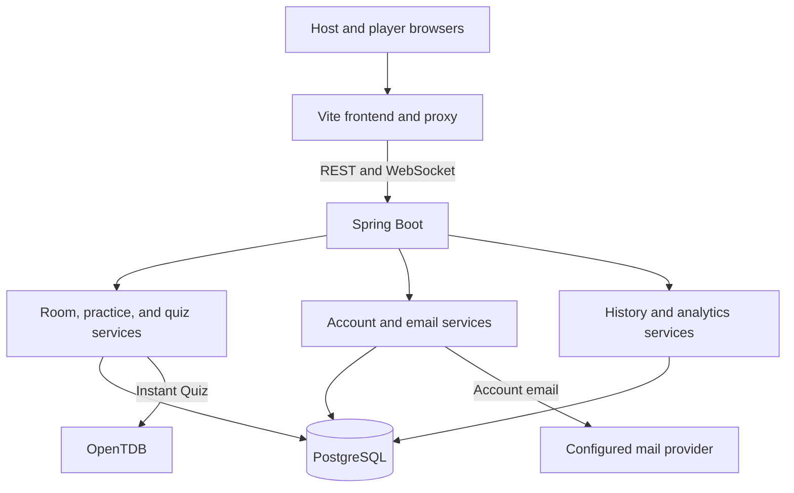
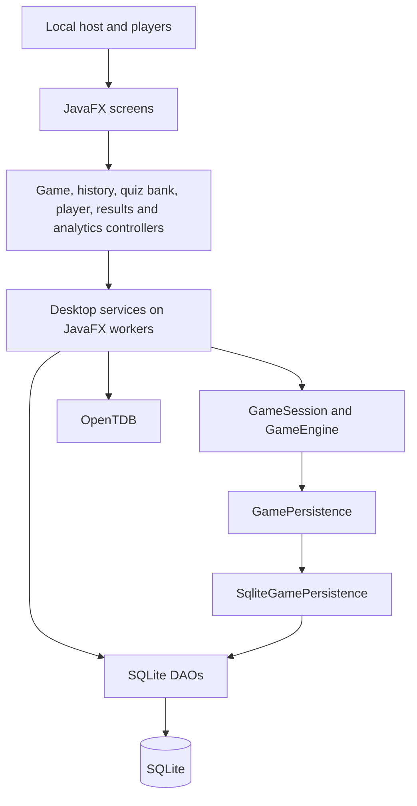
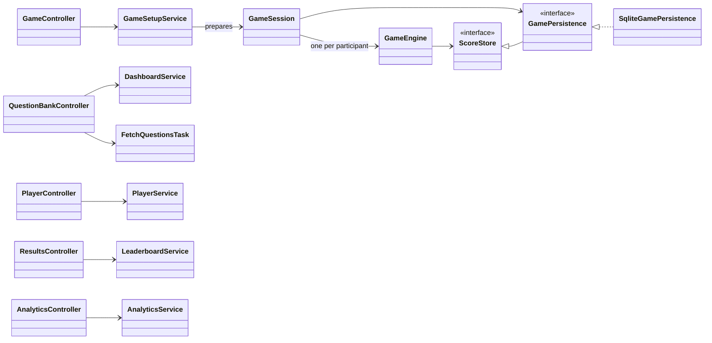
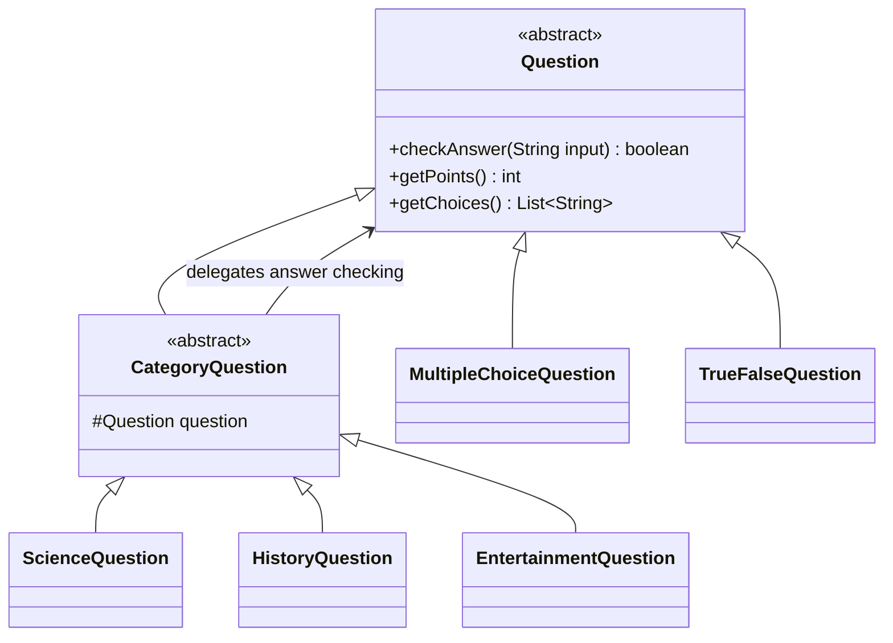
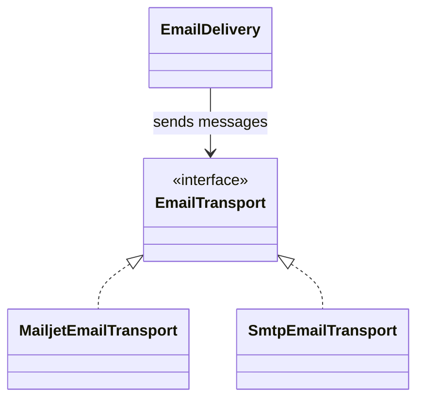
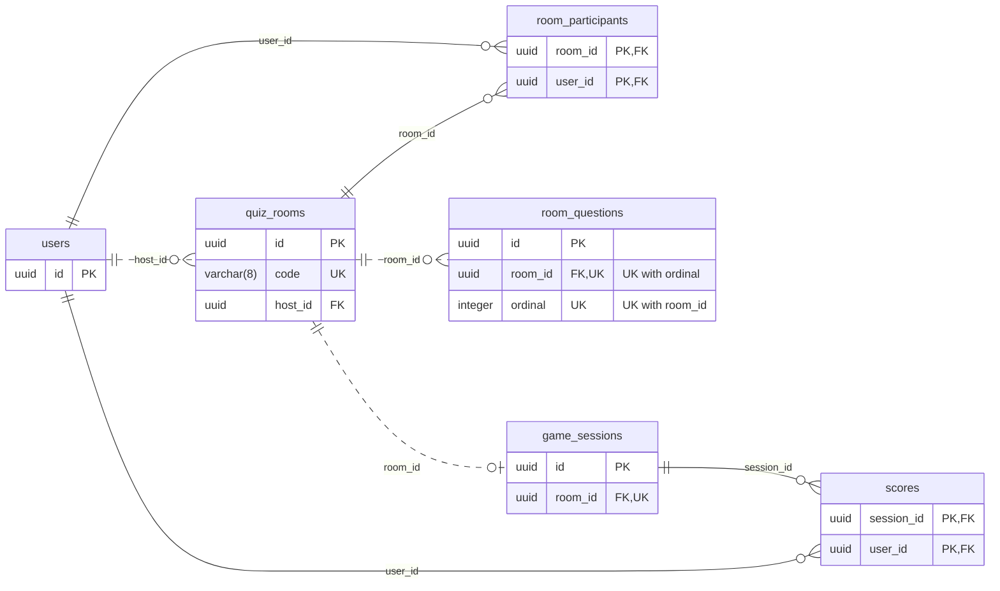
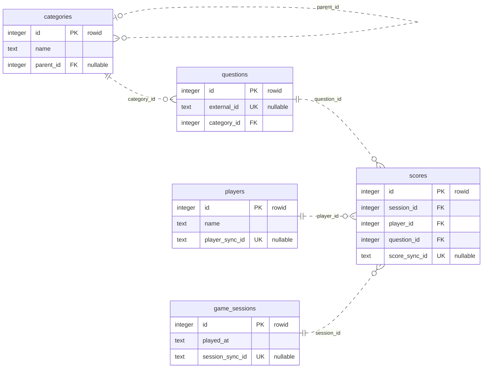
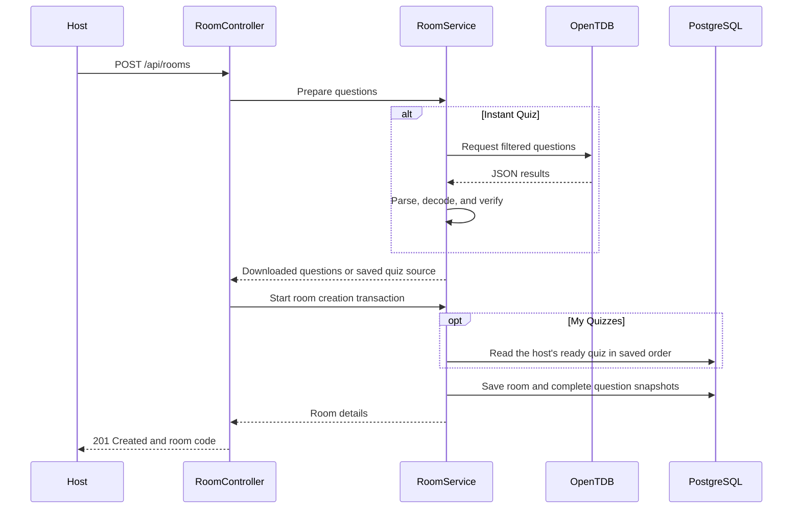
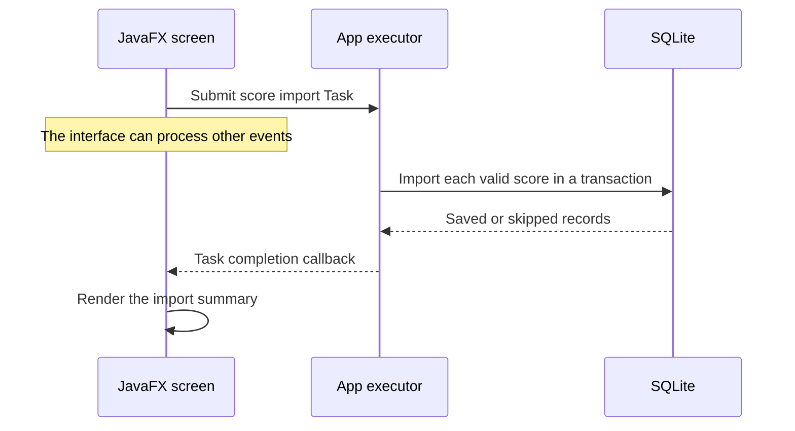
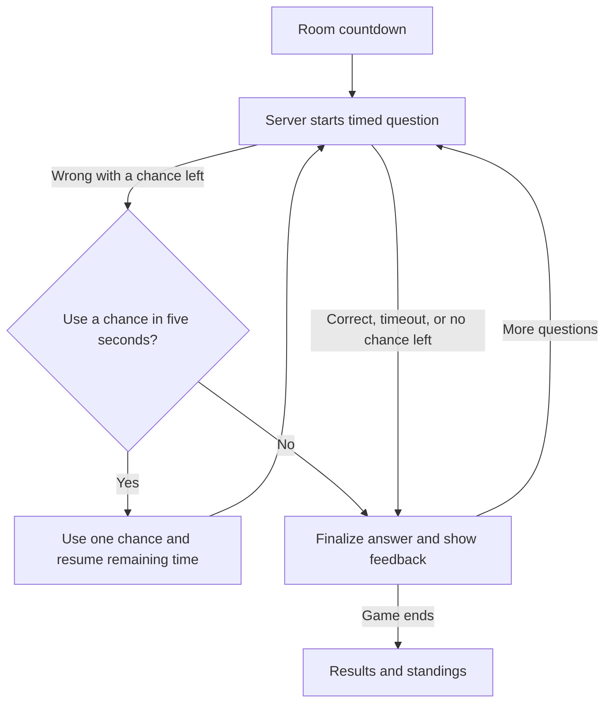

# Trivia & Quiz Night Manager

Project Design Document · Hootly

University of Cebu 
Computer Engineering Department

Table 1. Project information

| Item | Details |
|---|---|
| Project title | Trivia & Quiz Night Manager |
| Application | Hootly |
| Course and section | CPE 314 — Software Design, Section 3A |
| Team | 02 |
| Prepared for | Richyll Son |
| Term | First Semester, S.Y. 2026–2027 |
| Document version | V1.0 |
| Date | 18 November 2026 |

Table 2. Team 02

| Member | Student ID |
|---|---|
| John Daevin S. Simbajon | 25245093 |
| Justine B. Cuizon | 25245374 |
| Joshua Neil G. Malaya | 25209073 |
| Clarence Philip A. Elegino | 25260068 |
| Gebrielle P. Mirasol | 25207549 |

## Table of Contents

[Revision History](#revision-history)

1. [Introduction and Project Overview](#1-introduction-and-project-overview)
2. [ER Sketch and Team Roles](#2-er-sketch-and-team-roles)
3. [System Architecture and OOP Design](#3-system-architecture-and-oop-design)
4. [Data Model and Database Design](#4-data-model-and-database-design)
5. [API Integration Design](#5-api-integration-design)
6. [Concurrency Design](#6-concurrency-design)
7. [Data Mining and Visualization](#7-data-mining-and-visualization)
8. [Testing Summary](#8-testing-summary)
9. [Individual Contributions](#9-individual-contributions)

[References](#references) · [Appendices](#appendices)

## Revision History

Table 3. Design document revisions

| Version | Date | Changes |
|---|---|---|
| V0.1 | 24–26 October 2026 | The original revision table records the project overview and preliminary ER sketch. That history is preserved in `6335ffa`. |
| V0.2 | 28 October 2026 | The first tracked design document adds the architecture and data model. See `dfc18e6`. |
| V0.3 | 5–6 November 2026 | The team added API and concurrency design and updated the overview and database notes. See `5f6cb34` and `9fb73cc`. |
| V0.4 | 12–14 November 2026 | The team revised the ER sketch, setup, data model, and remaining technical sections. See `e84a472`, `c87d4da`, and `6335ffa`. |
| V1.0 | 18 November 2026 | Updated online and desktop architecture, database diagrams, test results, and contribution records. The source history is recorded through `f64a223`. |

## 1. Introduction and Project Overview

### Problem statement

A trivia host needs to prepare questions, manage turns and timing, and collect scores. When these steps are done by hand, players have limited access to past results and hosts must track each game separately.

### Objectives

- Let a host run a quiz while players join from their own devices.
- Give hosts a choice between fresh OpenTDB questions and questions they have saved.
- Keep the question set and scoring rules consistent for the duration of a game.
- Save results so players can review their performance and compare statistics with consent.

### Users and scope

Hootly Online is the main application. It is intended for classmates, friends, and groups running informal quiz sessions. An account can host one room and participate as a player in another. A host creates the room, shares its code, starts play, and monitors progress. Players join with the code and answer independently in new rooms. The host watches and does not earn player points in that flow.

The browser application includes account verification, room play, private quiz management and practice, results, history, and analytics. Instant Quiz depends on OpenTDB and account email depends on the configured mail provider. The retained JavaFX application runs local games and stores them in its own SQLite file. The sections below describe both applications.

## 2. ER Sketch and Team Roles

The preliminary sketch from the [original proposal](proposal.md) shows the first data model. The online design now centers on user accounts, rooms, question snapshots, sessions, and results. The desktop model links players to sessions through `session_players`. The current keys and relationships appear in [Section 4](#4-data-model-and-database-design).

Figure 1. Original preliminary ER sketch from the M3 repository history (`7985c96`).

Table 4. Team roles from the original proposal

| Member | Assigned role |
|---|---|
| John Daevin S. Simbajon | Team lead, integration, and project setup |
| Justine B. Cuizon | Database, data, and API integration |
| Joshua Neil G. Malaya | Interface design and JavaFX |
| Clarence Philip A. Elegino | Object-oriented design and gameplay |
| Gebrielle P. Mirasol | Analytics and testing |

## 3. System Architecture and OOP Design

### Hootly Online

The browser sends actions to the Spring Boot REST API and receives room notifications through WebSockets. Services check account ownership and room roles. Repositories save data in PostgreSQL, and the backend determines whether answers arrived in time. The frontend uses the same backend through the Vite proxy.

Figure 2. Hootly Online architecture.

Spring Security checks the authenticated account and the application checks permissions for each room, quiz, or report. The session is stored through Spring Session JDBC. User passwords use BCrypt. The backend build reuses Java question models and the OpenTDB client from the desktop source tree.

### JavaFX desktop

Figure 3. JavaFX desktop architecture.

App starts JavaFX and Navigator opens screens. Dedicated controllers prepare background work for games, score history, the question bank, players, results, and analytics. GameSession and GameEngine use storage interfaces. SqliteGamePersistence adapts these operations to SQLite. Production packages separate models, DTOs, controllers, services, DAOs, and UI classes.

Figure 4. Desktop gameplay persistence interfaces and dependencies.

### UML class diagram

The shared `Question` type represents question formats. The desktop mapper can wrap a format in a category question. A category wrapper delegates answer checks to its question and supplies the category’s point rule. Science adds half the base points, History adds one point, and Entertainment uses the base points. Online competitive rooms use the retry schedule in `ScoringService`.

Figure 5. Question formats and desktop category scoring.

The online email service uses the `EmailTransport` interface. Spring selects the Mailjet or SMTP implementation from the configured provider.

Figure 6. Online email transport interface.

### Data structures and recursion

The desktop `GameEngine` uses an `ArrayDeque` as a queue for questions and a separate deque as a stack for scored-answer undo. `LeaderboardService` uses a map indexed by player ID. `CategoryDao` traverses nested categories recursively. Online, `PracticeEngine` uses a queue and undo history for a private practice session. `CategoryTree` recursively visits user-owned category branches. Online multiplayer persists the question order and player progress in PostgreSQL.

## 4. Data Model and Database Design

Hootly Online uses PostgreSQL. The database stores accounts, quiz collections, room snapshots, game and answer records, and statistics sharing. A room has at most one game session. The `room_participants` junction table links users to rooms, and `scores` records a user’s session total. Individual online answers reference `room_questions`. A snapshot from Instant Quiz may have no source question FK. A snapshot for a saved quiz links to the saved question. Both store the contents used in that game, including the answer choices.

The desktop application uses SQLite. `session_players` links players to sessions, and each desktop score has a required `question_id`. Score categories are read through questions. Player, session, and score synchronization IDs help identify records when history is exported and reimported. Display names can repeat because each player has a separate identity.

Table 5. Database schema sources and diagram locations

| Database | Schema source | Diagram |
|---|---|---|
| PostgreSQL | [SQL migrations](../online/backend/src/main/resources/db/migration/) and [Java migrations](../online/backend/src/main/java/db/migration/) | [PostgreSQL ERDs](ERD.md#postgresql-for-hootly-online) |
| SQLite | [Database.java](../src/main/java/com/triviagame/dao/Database.java), [SessionPlayerDao.java](../src/main/java/com/triviagame/dao/SessionPlayerDao.java), [TimedAnswerDao.java](../src/main/java/com/triviagame/dao/TimedAnswerDao.java), and [QuestionBankService.java](../src/main/java/com/triviagame/service/QuestionBankService.java) | [SQLite ERD](ERD.md#sqlite-for-the-javafx-desktop-application) |

The full ERDs distinguish nullable FKs, single-column and composite keys, and unique indexes. The next figure shows the core PostgreSQL room relationships. The detailed ERD includes quiz ownership, source questions, accounts, practice, retry decisions, email deliveries, and statistics sharing.

Figure 7. Core PostgreSQL room and score relationships.

The SQLite diagram focuses on the score relationships. The [full SQLite ERD](ERD.md#sqlite-for-the-javafx-desktop-application) includes `session_players`, `timed_answers`, and `question_bank_imports`, as well as all columns and key definitions.

Figure 8. Core SQLite score relationships.

## 5. API Integration Design

`OpenTdbClient` uses the Java HTTP Client to call `https://opentdb.com/api.php` for question data and `https://opentdb.com/api_category.php` for category data. The question request sends `amount` (1 to 50) and `encode=url3986`. It sends `category`, `difficulty`, and `type` when the host selects specific filters. Difficulty can be easy, medium, or hard. Type can be multiple choice or true/false.

Table 6. OpenTDB request and response handling

| Step | Source and result |
|---|---|
| Request and parse | `OpenTdbClient` sends the request. `OpenTdbResponseParser` reads `response_code` and `results` into DTOs. |
| Map and decode | `OpenTdbQuestionMapper` decodes question text and the correct and incorrect answers into question records. The client reports success, an empty result, or failure. |
| Check and save | `OpenTriviaService` checks the official category, difficulty, and type. It asks for more results within its retry limit if necessary. `RoomService` writes the snapshots when it can fill the room. |
| Handle limits | Hootly spaces requests five seconds apart by default and preserves a valid cached category list when the category API is unavailable. If the question API is unavailable or returns too few distinct matches, the host can change the filters or use a saved quiz. |

Figure 9. Room creation and OpenTDB request sequence.

The quiz API also accepts JSON as a private draft. Separately, a signed statistics export can be imported into Compare Players. Signature checks establish the originating account when available. The user receiving a request must approve it before the importer can view live updates. Import jobs keep duplicate handling and conflict checks separate from official scores.

The OpenTDB response contains a numeric `response_code` and a `results` array. A question result includes the category, type, difficulty, question text, correct answer, and incorrect answers. The repository includes a [captured response fixture](../src/test/resources/opentdb/live-response-2026-11-17.json). Room endpoints use session authentication. The backend checks the host role on `POST /api/rooms/{code}/start` and the player role on `POST /api/rooms/{code}/answers`. Requests from non-members are rejected before room state is returned.

## 6. Concurrency Design

Table 7. Background work and interface updates

| Application | Work handled separately | Interface update |
|---|---|---|
| JavaFX | `App` owns a fixed executor. Tasks initialize the database, load dashboard and player data, prepare games, fetch questions, import or export histories, and query charts. | JavaFX task handlers update the screens. `App.stop()` shuts down the executor. |
| Online rooms | HTTP requests prepare questions before the room write transaction. Room state transitions use transaction locks. `GameScheduler` handles deadlines and `RoomSockets` sends room events. | Players receive a room update and read the current state. A player’s own clock and answer status come from the server. |
| Online imports and email | `StatisticsImportJobs` and `EmailDelivery` use bounded worker pools. | The browser polls import progress. Account workflows record delivery attempts separately. |

Figure 10. Background score import and JavaFX completion callback.

A new room starts with a countdown. A wrong answer can open a five-second chance decision if the player has chances left. The player’s question timer pauses during that decision. The server accepts an answer once, records the final result, and starts the next question after feedback.

Figure 11. Server-controlled online question, chance, and results flow.

Automated tests use a controlled clock for deadline and retry behavior. Local import checks confirmed that JavaFX kept updating during a 2,000-record import. Room updates across two physical devices still need testing.

## 7. Data Mining and Visualization

Online reports read completed games, answers, and scores from PostgreSQL. The frontend summarizes points, wins, and accuracy. Charts show accuracy by category and points over time. Player comparisons are based on imported game histories and data shared with the account owner’s approval.

The desktop `AnalyticsDao` groups stored results by category, session, and player ID. It calculates category accuracy as correct answers divided by total recorded answers, and it reads the score history in session order. A bar chart shows discrete category accuracy side by side. A line chart shows the order and direction of changes across sessions. Imported scores contribute to the same desktop queries.

## 8. Testing Summary

The desktop Maven suite uses an isolated SQLite file. The backend suite uses H2 and disposable PostgreSQL containers. Email tests capture or mock delivery. Frontend tests cover component interactions and user flows. See [Testing](TESTING.md) for commands and manual checks.

Table 8. Automated results from 18 November 2026

| Suite | Test classes or files | Passed | Failed | Skipped |
| --- | ---: | ---: | ---: | ---: |
| Desktop | 25 | 189 | 0 | 0 |
| Backend unit and application tests | 30 | 117 | 0 | 0 |
| PostgreSQL | 9 | 53 | 0 | 0 |
| Vitest | 22 | 137 | 0 | 0 |
| Playwright | 2 | 2 | 0 | 0 |

The Java suites passed after the package and exception-handling changes. Frontend tests and the production build also passed on 18 November 2026.

Table 9. JaCoCo coverage from executed JUnit tests

| Code measured | Line coverage | Branch coverage |
| --- | ---: | ---: |
| Desktop | 1702/3371 (50.5%) | 659/1321 (49.9%) |
| Online backend and shared compiled Java | 2875/3304 (87.0%) | 1261/1860 (67.8%) |

Coverage includes production classes in each Maven test run. The desktop total includes JavaFX screen code. Online coverage combines the H2 and disposable PostgreSQL runs. It excludes React and browser tests.

### Desktop test classes

Table 10. Desktop JUnit test cases by class

| Test class | Passed | Edge case exercised |
| --- | ---: | --- |
| `OpenTdbClientTest` | 31 | Rejects invalid type before sending request. |
| `OpenTdbContractTest` | 2 | Upstream aliases and coerced field types are not accepted. |
| `QuestionParserTest` | 32 | Rejects invalid JSON and non text answers. |
| `CategoryTest` | 5 | Find category at any depth ignoring case. |
| `GameControllerTest` | 2 | Insufficient question selection does not create a game session. |
| `AnalyticsDaoTest` | 9 | Invalid player ID for session points. |
| `AnalyticsInsightsTest` | 9 | Player with only wrong answers. |
| `CategoryDaoTest` | 4 | Invalid category name. |
| `DatabaseTest` | 8 | Failed schema migration rolls back backfill and preserves existing rows. |
| `PlayerDaoTest` | 2 | Empty player name. |
| `PlayerSetupTest` | 3 | Rejects invalid seconds. |
| `QuestionDaoTest` | 3 | Invalid question. |
| `QuestionImportTest` | 8 | Concurrent imports do not duplicate questions or categories. |
| `ScoreDaoTest` | 4 | Invalid score inputs. |
| `ScoreIdentityRoundTripTest` | 1 | Same name players remain separate in export and import. |
| `ScoreJsonImporterTest` | 10 | Import malformed JSON. |
| `ScoreSchemaMigrationTest` | 4 | Conflicting score with timed answer aborts without breaking their link. |
| `GameEngineDatabaseTest` | 7 | Question without database ID is rejected. |
| `GameEngineTest` | 20 | Wrong answer scores zero and advances. |
| `GameSessionTimingTest` | 3 | Engine enforces deadline and undo does not extend it. |
| `CategoryQuestionTest` | 2 | Unrecognized category keeps the base question and its scoring. |
| `MultipleChoiceQuestionTest` | 10 | Out of range positions are wrong. |
| `TrueFalseQuestionTest` | 7 | Invalid input is wrong. |
| `GameSetupServiceTest` | 1 | Filters count and load the same questions across nested categories. |
| `FetchQuestionsTaskTest` | 2 | Fetch failure is propagated and questions are not imported. |

### Online backend test classes

Table 11. Backend JUnit test cases by class

| Test class | Passed | Edge case exercised |
| --- | ---: | --- |
| `AccountDeletionTest` | 6 | Erases personal fields and credentials and invalidates every device. |
| `SnapshotValidationTest` | 1 | Accepts actual timeout and retry relationships. |
| `AnalyticsExportTest` | 3 | Historical unknown attempt and timing fields stay unavailable. |
| `AnalyticsTest` | 3 | Finished statistics are private and exclude unfinished games. |
| `AuthenticationTest` | 7 | Rejects missing CSRF and invalid credentials and unapproved origins. |
| `AvatarConfigTest` | 3 | Missing or invalid stored legacy parameters use stable fallback. |
| `AvatarTest` | 4 | Every species persists without changing the palette and invalid species are rejected. |
| `CategoryTreeTest` | 1 | Traversal handles nested branches cycles and missing roots. |
| `DatabaseTimesTest` | 2 | Rejects missing and unsupported database values. |
| `DepartureTest` | 2 | Leaving does not invent timeouts or award wins and does not remove real submitted answers. |
| `EmailSecurityTest` | 10 | Exact account recipient and name survive recovery without automatic or duplicate mail. |
| `EmailTemplatesTest` | 2 | Templates escape names and contain accessible inline branding. |
| `EmptyBankInstantQuizTest` | 1 | Fresh provider questions create a stable room with zero bank records. |
| `ForwardedAuthenticationTest` | 2 | Trusted HTTPS password recovery sets and clears secure purpose restricted cookie. |
| `IndependentGameplayTest` | 12 | Concurrent duplicate submissions cannot award points twice. |
| `LoginRateLimiterTest` | 2 | Rate limit expires at the five minute boundary. |
| `EmailDeliveryTrackingTest` | 3 | Uncertain network failure is not reported as sent. |
| `MailjetEmailTransportTest` | 4 | Rejects invalid responses and handles rate limits without retrying. |
| `OpenTriviaTest` | 7 | Malformed category caches cannot become official lists. |
| `PersonalQuizTest` | 7 | Quiz edits reorder safely reuse questions and reject stale versions. |
| `PracticeEngineTest` | 2 | Invalid actions never consume questions or alter score. |
| `PracticeTest` | 2 | Practice is private persistent idempotent and never changes competitive statistics. |
| `ProfileEditingTest` | 2 | Concurrent username edits have one winner and keep both account identities. |
| `RetryGameTest` | 3 | Concurrent duplicate submissions consume one chance and replay survives deadline. |
| `RetryScoringTest` | 5 | Optional retry settings default off and reject coercion and unsupported values. |
| `RoomGameTest` | 7 | Only host can control room and outsiders cannot read it. |
| `RoomQuestionSourcesTest` | 5 | Legacy lobby with matching count but missing first position cannot start. |
| `RoomRemovalTest` | 2 | Voluntary departure is not a kick and rejoining clears the removal flag. |
| `StatisticsSharingTest` | 5 | Denial cooldown and multiple connections are independent. |
| `WebSocketTest` | 2 | Rejects outsiders unauthenticated sockets and unapproved origins. |

### PostgreSQL integration test classes

Table 12. PostgreSQL JUnit test cases by class

| Test class | Passed | Edge case exercised |
| --- | ---: | --- |
| `DeparturePostgresIT` | 2 | Leaving does not invent timeouts or award wins and does not remove real submitted answers. |
| `EmailSecurityPostgresIT` | 10 | Exact account recipient and name survive recovery without automatic or duplicate mail. |
| `EmptyBankInstantQuizPostgresIT` | 1 | Fresh provider questions create a stable room with zero bank records. |
| `IndependentGameplayPostgresIT` | 12 | Concurrent duplicate submissions cannot award points twice. |
| `InstantQuizPostgresIT` | 7 | Malformed category caches cannot become official lists. |
| `PersonalQuizPostgresIT` | 7 | Quiz edits reorder safely reuse questions and reject stale versions. |
| `PostgresIT` | 7 | Only host can control room and outsiders cannot read it. |
| `PracticePostgresIT` | 2 | Practice is private persistent idempotent and never changes competitive statistics. |
| `StatisticsSharingPostgresIT` | 5 | Denial cooldown and multiple connections are independent. |

## 9. Individual Contributions

The table counts non-merge commits reachable from M3 at `f64a223`. It combines the author names and GitHub handles shown in the branch history. Added and removed lines are Git numstat totals for text changes across the repository. Binary files and current working-tree changes are excluded. The source file and commit in each row are representative. The original assignment of roles remains in the [proposal](proposal.md).

Table 13. Individual contribution totals from Git

| Member | Commits | Lines added | Lines removed | Representative work |
| --- | ---: | ---: | ---: | --- |
| John Daevin S. Simbajon | 45 | 8,214 | 1,164 | React/Vite frontend and local setup |
| Justine B. Cuizon | 56 | 15,511 | 6,584 | Score normalization and identity-safe migration and import |
| Joshua Neil G. Malaya | 42 | 6,808 | 1,310 | Online room creation interface |
| Clarence Philip A. Elegino | 82 | 4,744 | 314 | Independent multiplayer progression |
| Gebrielle P. Mirasol | 17 | 23,617 | 107 | Desktop analytics queries and test cases |

Representative source files and commits

- John Daevin S. Simbajon · [package.json](../online/frontend/package.json) (`86d8d1f`).
- Justine B. Cuizon · [Database.java](../src/main/java/com/triviagame/dao/Database.java) (`cab4e44`), [ScoreJsonImporter.java](../src/main/java/com/triviagame/dao/ScoreJsonImporter.java) (`cab4e44`).
- Joshua Neil G. Malaya · [CreateRoomPage.tsx](../online/frontend/src/CreateRoomPage.tsx) (`949e290`).
- Clarence Philip A. Elegino · [IndependentGame.java](../online/backend/src/main/java/com/triviagame/online/rooms/IndependentGame.java) (`273b2b6`).
- Gebrielle P. Mirasol · [AnalyticsDao.java](../src/main/java/com/triviagame/dao/AnalyticsDao.java) (`2396491`), [AnalyticsInsightsTest.java](../src/test/java/com/triviagame/dao/AnalyticsInsightsTest.java) (`5722e44`).

## References

- [Project Specification and Rubric](../professor-references/Project_Specification_and_Rubric.pdf), [Week 09 Checklist](../professor-references/Week09_Checklist.pdf), and [Week 10 Checklist](../professor-references/Week10_Checklist.pdf).
- [Week 10 Design Document Checklist](../professor-references/Week10_DesignDoc_Checklist.pdf), [W10 Team 02 Quiz Night Host](../professor-references/W10_3A_team-02_Quiz_Night_Host.pdf), [Additional A2 Quiz Night Host](../professor-references/Additional_A2_Quiz_Night_Host.pdf), and [Week 11 Check A2](../professor-references/Week11_Check_A2.pdf).
- Open Trivia Database, [API documentation](https://opentdb.com/api_config.php).

## Appendices

- [Original project proposal](proposal.md)
- [Full database ERDs and key tables](ERD.md)
- [Requirements and known issues](KNOWN_ISSUES.md)
- [Testing commands and results](TESTING.md)
