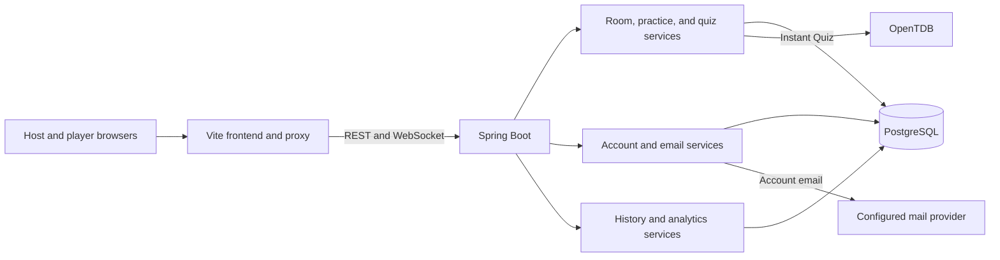
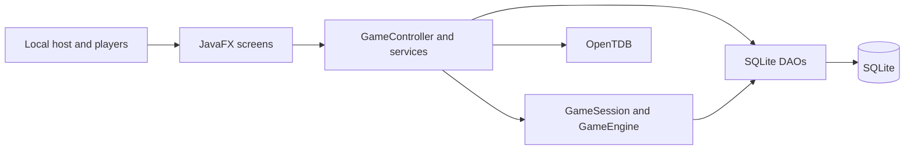
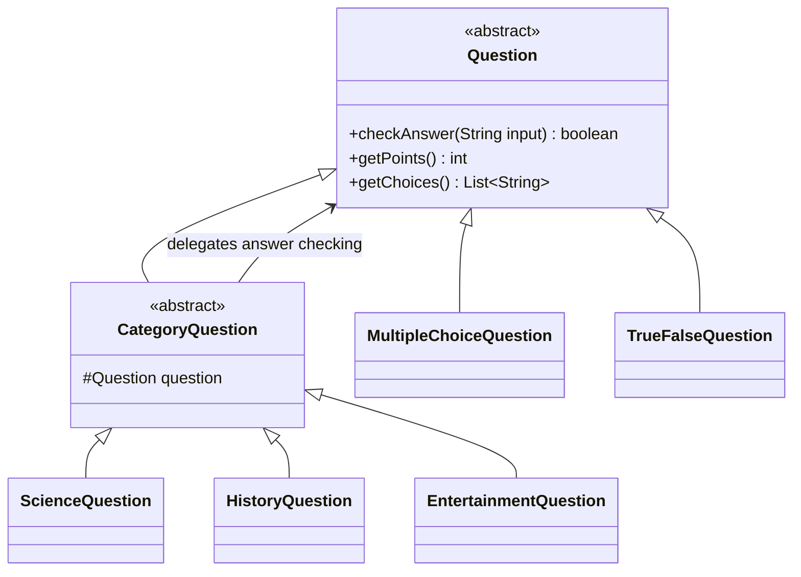
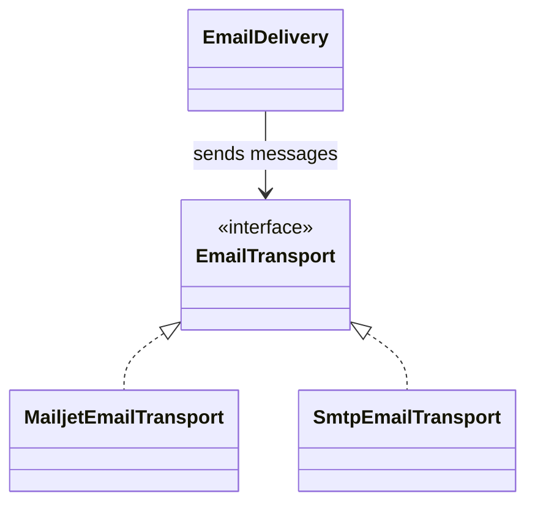
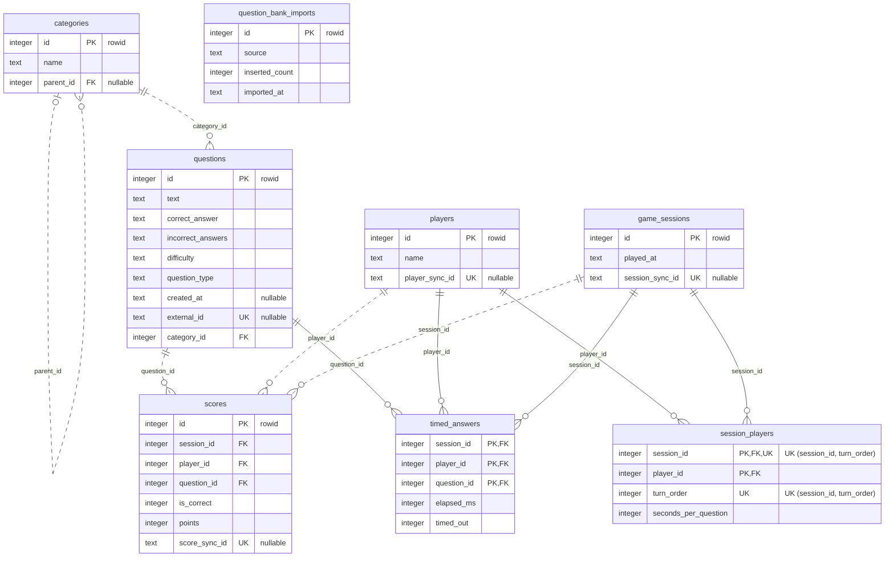
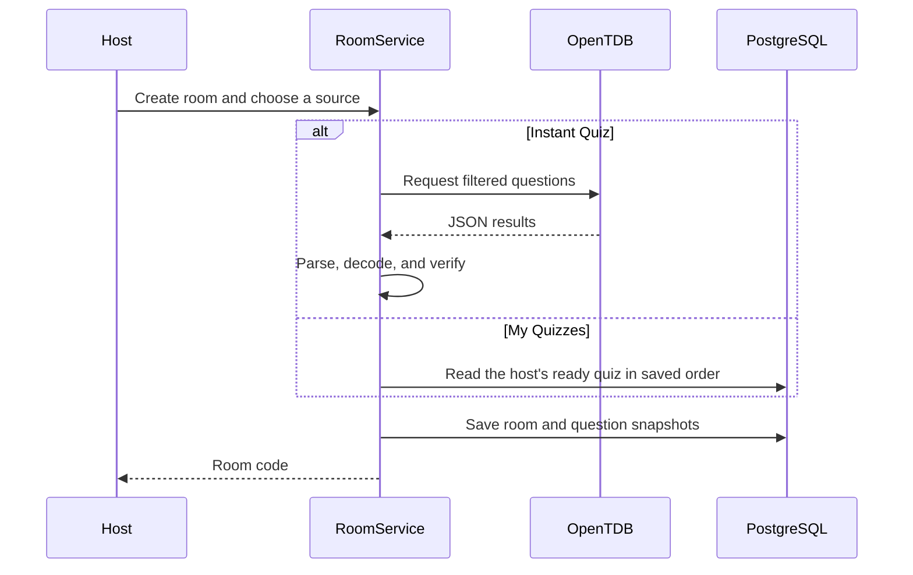
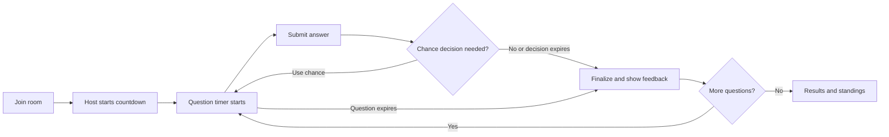

# Hootly — Project Design Document

| Item | Details |
|---|---|
| Project title | Trivia & Quiz Game Night Manager |
| Application | Hootly |
| Course and section | CPE 314 — Software Design, Section 3A |
| Team | 02 |
| Instructor | Richyll Son |
| Revision | 1.1 |
| Date | 18 November 2026 |

## Table of Contents

1. [Introduction and Project Overview](#1-introduction-and-project-overview)
2. [ER Sketch and Team Roles](#2-er-sketch-and-team-roles)
3. [System Architecture and OOP Design](#3-system-architecture-and-oop-design)
4. [Data Model and Database Design](#4-data-model-and-database-design)
5. [API Integration Design](#5-api-integration-design)
6. [Concurrency Design](#6-concurrency-design)
7. [Data Mining and Visualization](#7-data-mining-and-visualization)
8. [Testing Summary](#8-testing-summary)
9. [Individual Contributions](#9-individual-contributions)

[References](#references) · [Appendices](#appendices)

## 1. Introduction and Project Overview

### Problem statement

A trivia host needs to prepare questions, manage turns and timing, and collect scores. When these steps are done by hand, players have limited access to past results and hosts must track each game separately.

### Objectives

- Let a host run a quiz while players join from their own devices.
- Give hosts a choice between fresh OpenTDB questions and questions they have saved.
- Keep the question set and scoring rules consistent for the duration of a game.
- Save results so players can review their performance and compare statistics with consent.

### Users and scope

Hootly Online is the main application. It is intended for classmates, friends, and groups running informal quiz sessions. An account can host one room and participate as a player in another. A host creates the room, shares its code, starts play, and monitors progress. Players join with the code and answer independently in new rooms. The host watches and does not earn player points in that flow.

The browser application includes account verification, room play, private quiz management and practice, results, history, and analytics. Instant Quiz depends on OpenTDB and account email depends on the configured mail provider. The retained JavaFX application runs local games and stores them in its own SQLite file. Its course features are identified separately below.

## 2. ER Sketch and Team Roles

The [original proposal](proposal.md) preserves the preliminary design. The current model centers on accounts, rooms, question snapshots, sessions, and results. In the desktop model, players and sessions are linked through `session_players`. The full entity relationships and keys are in [Section 4](#4-data-model-and-database-design).

| Member | Assigned role |
|---|---|
| John Daevin S. Simbajon | Team lead, integration, and project setup |
| Justine B. Cuizon | Database, data, and API integration |
| Joshua Neil G. Malaya | Interface design and JavaFX |
| Clarence Philip A. Elegino | Object-oriented design and gameplay |
| Gebrielle P. Mirasol | Analytics and testing |

## 3. System Architecture and OOP Design

### Hootly Online

The browser sends actions to the Spring Boot REST API and receives room notifications through WebSockets. Services check account ownership and room roles. Repositories save data in PostgreSQL, and the backend determines whether answers arrived in time. The frontend uses the same backend through the Vite proxy.

Spring Security checks the authenticated account and the application checks permissions for each room, quiz, or report. The session is stored through Spring Session JDBC. User passwords use BCrypt. The backend build reuses Java question models and the OpenTDB client from the desktop source tree.

### JavaFX desktop

`App` starts JavaFX. `Navigator` opens screens, and `GameController` prepares games. The screens delegate work to controllers and services, although `GameSession` still has DAO dependencies and some screen coordination remains in views.

### UML class diagram

The shared `Question` type represents question formats. The desktop mapper can wrap a format in a category question. A category wrapper delegates answer checks to its question and supplies the category’s point rule. Science adds half the base points, History adds one point, and Entertainment uses the base points. Online competitive rooms use the retry schedule in `ScoringService`.

The online email service uses the `EmailTransport` interface. Spring selects the Mailjet or SMTP implementation from the configured provider.

### Data structures and recursion

The desktop `GameEngine` uses an `ArrayDeque` as a queue for questions and a separate deque as a stack for scored-answer undo. `LeaderboardService` uses a map indexed by player ID. `CategoryDao` traverses nested categories recursively. Online, `PracticeEngine` uses a queue and undo history for a private practice session. `CategoryTree` recursively visits user-owned category branches. Online multiplayer persists the question order and player progress in PostgreSQL.

## 4. Data Model and Database Design

Hootly Online uses PostgreSQL. The database stores accounts, quiz collections, room snapshots, game and answer records, and statistics sharing. A room has at most one game session. The `room_participants` junction table links users to rooms, and `scores` records a user’s session total. Individual online answers reference `room_questions`. A snapshot from Instant Quiz may have no source question FK. A snapshot for a saved quiz links to the saved question. Both store the contents used in that game, including the answer choices.

The desktop application uses SQLite. `session_players` links players to sessions, and each desktop score has a required `question_id`. Score categories are read through questions. Player, session, and score synchronization IDs help identify records when history is exported and reimported. Display names can repeat because each player has a separate identity.

| Database | Schema source | Diagram |
|---|---|---|
| PostgreSQL | [SQL migrations](../online/backend/src/main/resources/db/migration/) and [Java migrations](../online/backend/src/main/java/db/migration/) | [PostgreSQL ERDs](ERD.md#postgresql-for-hootly-online) |
| SQLite | [Database.java](../src/main/java/com/triviagame/db/Database.java), [SessionPlayerDao.java](../src/main/java/com/triviagame/db/SessionPlayerDao.java), [TimedAnswerDao.java](../src/main/java/com/triviagame/db/TimedAnswerDao.java), and [QuestionBankService.java](../src/main/java/com/triviagame/service/QuestionBankService.java) | [SQLite ERD](ERD.md#sqlite-for-the-javafx-desktop-application) |

The full ERDs distinguish nullable FKs, single-column and composite keys, and unique indexes. The SQLite desktop ERD is shown here for the course requirement.

## 5. API Integration Design

`OpenTdbClient` uses the Java HTTP Client to call `https://opentdb.com/api.php` for question data and `https://opentdb.com/api_category.php` for category data. The question request sends `amount` (1 to 50) and `encode=url3986`. It sends `category`, `difficulty`, and `type` when the host selects specific filters. Difficulty can be easy, medium, or hard. Type can be multiple choice or true/false.

| Step | Source and result |
|---|---|
| Request and parse | `OpenTdbClient` sends the request. `OpenTdbResponseParser` reads `response_code` and `results` into DTOs. |
| Map and decode | `OpenTdbQuestionMapper` decodes question text and the correct and incorrect answers into question records. The client reports success, an empty result, or failure. |
| Check and save | `OpenTriviaService` checks the official category, difficulty, and type. It asks for more results within its retry limit if necessary. `RoomService` writes the snapshots when it can fill the room. |
| Handle limits | Hootly spaces requests five seconds apart by default and preserves a valid cached category list when the category API is unavailable. If the question API is unavailable or returns too few distinct matches, the host can change the filters or use a saved quiz. |

The quiz API also accepts JSON as a private draft. Separately, a signed statistics export can be imported into Compare Players. Signature checks establish the originating account when available. The user receiving a request must approve it before the importer can view live updates. Import jobs keep duplicate handling and conflict checks separate from official scores.

## 6. Concurrency Design

| Application | Work handled separately | Interface update |
|---|---|---|
| JavaFX | `App` owns a fixed executor. Tasks initialize the database, load dashboard and player data, prepare games, fetch questions, import or export histories, and query charts. | JavaFX task handlers update the screens. `App.stop()` shuts down the executor. |
| Online rooms | HTTP requests prepare questions before the room write transaction. Room state transitions use transaction locks. `GameScheduler` handles deadlines and `RoomSockets` sends room events. | Players receive a room update and read the current state. A player’s own clock and answer status come from the server. |
| Online imports and email | `StatisticsImportJobs` and `EmailDelivery` use bounded worker pools. | The browser polls import progress. Account workflows record delivery attempts separately. |

A new room starts with a countdown. A wrong answer can open a five-second chance decision if the player has chances left. The player’s question timer pauses during that decision. The server accepts an answer once, records the final result, and starts the next question after feedback.

Automated tests use a controlled clock for deadline and retry behavior. The final demonstration should also check responsiveness during desktop import and room updates across separate devices.

## 7. Data Mining and Visualization

Online reports read completed games, answers, and scores from PostgreSQL. The frontend summarizes points, wins, and accuracy. Charts show accuracy by category and points over time. Player comparisons are based on imported game histories and data shared with the account owner’s approval.

The desktop `AnalyticsDao` groups saved results by category, session, and player ID. The analytics screen uses a bar chart to compare categories and a line chart to show changes across games. An imported history can change the chart because its records are included in the same queries.

## 8. Testing Summary

The desktop Maven suite uses a test SQLite file. Online backend tests use H2 and disposable PostgreSQL containers. Frontend tests cover components and user flows. [Testing](TESTING.md) records the actual results, commands, and remaining manual checks.

## 9. Individual Contributions

The examples below come from commits in the current branch’s history. The team’s original allocation remains in the [proposal](proposal.md).

| Member | Example contribution | Git evidence |
|---|---|---|
| John Daevin S. Simbajon | Set up the React/Vite frontend and online local-development configuration. | `86d8d1f` |
| Justine B. Cuizon | Normalized desktop score storage and preserved player identities during migration and JSON import. | `cab4e44` |
| Joshua Neil G. Malaya | Implemented the room creation interface. | `949e290` |
| Clarence Philip A. Elegino | Implemented independent multiplayer progression. | `273b2b6` |
| Gebrielle P. Mirasol | Added desktop analytics queries and analytics test coverage. | `2396491`, `5722e44` |

## References

- *Project Specification and Rubric*, *Week 09 Checklist*, and *Week 10 Checklist*.
- *Week 10 Design Document Checklist*, *W10 Team 02 Quiz Night Host*, *Additional A2 Quiz Night Host*, and *Week 11 Check A2*.
- Open Trivia Database, [API documentation](https://opentdb.com/api_config.php).

## Appendices

- [Original project proposal](proposal.md)
- [Full database ERDs and key tables](ERD.md)
- [Professor corrections and requirements map](KNOWN_ISSUES.md)
- [Testing commands and results](TESTING.md)
