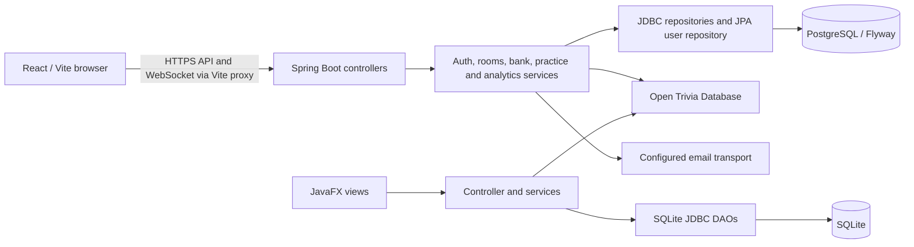
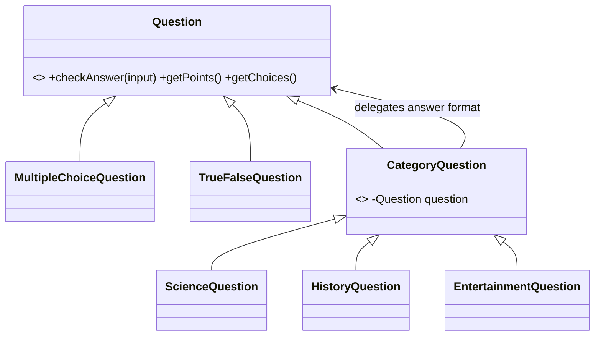
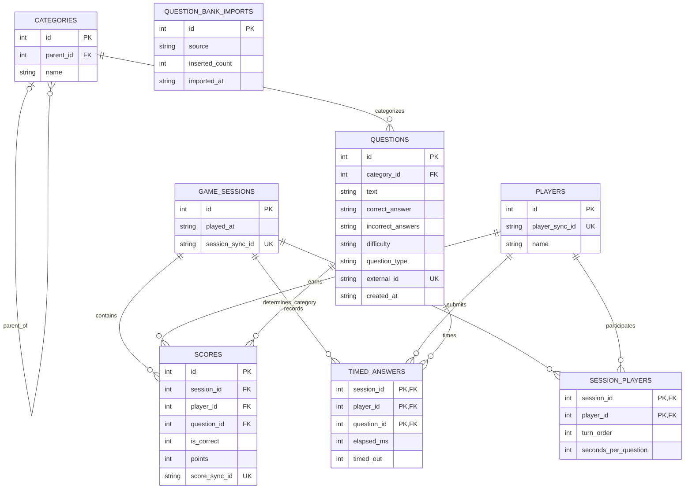
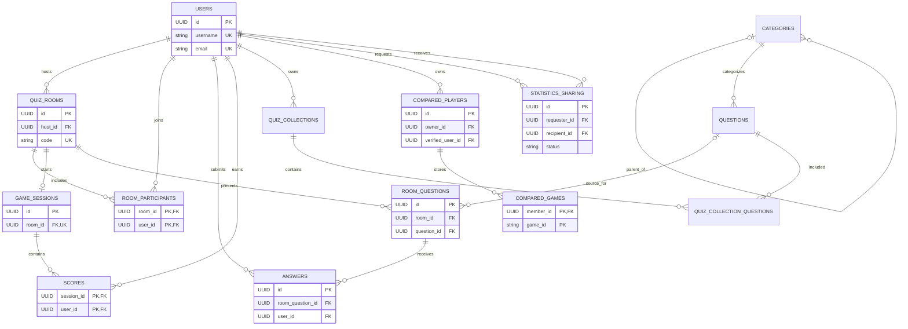
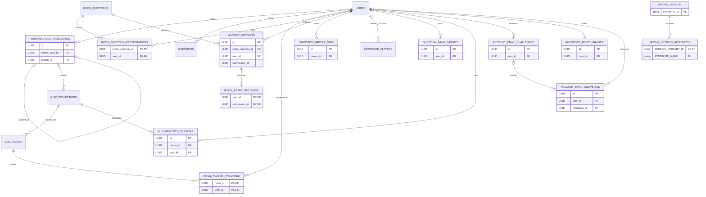
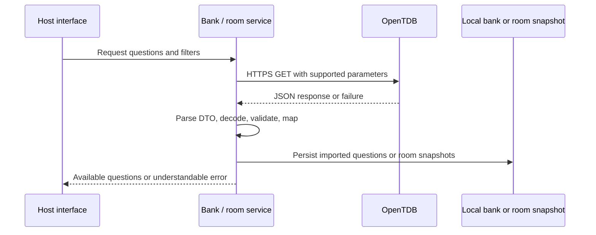
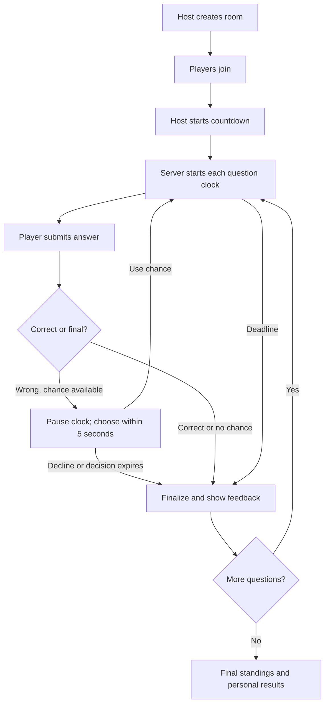

# Hootly — Project Design Document V1.0

CPE 314 Software Design · Section 3A · Team 02 · 18 November 2026

This document describes the current `project/milestone-3` source tree. The online and desktop applications use separate data stores. The diagrams are relationship overviews; the named schema sources are authoritative for all columns, constraints, later migrations, and indexes.

## 1. Introduction and project overview

Hootly is a trivia-night application. A host creates an online room, players join, answer timed questions, and review results. Users can build quizzes, use Open Trivia Database (OpenTDB) questions, export statistics, and compare imported histories. A recipient must consent before a comparison can update from their live account. The JavaFX application remains an offline desktop route for SQLite, timed games, score import and analytics.

## 2. ER sketch and team roles

The current entity relationships are shown in Section 4. Team roles below are the roles recorded in the existing project document and instructor review, not a claim that each person authored every current file. Each member should verify and explain their own final contributions at defense.

| Member | Documented role |
|---|---|
| John Daevin S. Simbajon | Team lead, integration and DevOps |
| Clarence Philip A. Elegino | Core object-oriented design and game logic |
| Justine B. Cuizon | Database, data and API |
| Joshua Neil G. Malaya | UI/UX and JavaFX |
| Gebrielle P. Mirasol | Analytics and QA |

## 3. System architecture and object-oriented design

`online/backend/src/main/java/com/triviagame/online` separates web controllers, domain services and repositories. The desktop entry point is `com.triviagame.App`; `GameController` and services mediate several view operations, though not all desktop logic has a dedicated controller and `GameSession` still constructs DAOs. This is a partial MVC separation, not a claim of full package purity.

Category decorators retain multiple-choice or true/false answer behavior while dynamically supplying category-specific scoring. `GameEngine` uses `ArrayDeque` as a FIFO question queue and as a LIFO scored-answer history. `NewGameScreen` exposes Undo. `Category.getAllQuestions` and `CategoryDao.getQuestionsRecursively` traverse nested categories; stable IDs and maps distinguish players with identical names.

## 4. Data model and database design

### SQLite desktop ERD

The core schema and preservation-oriented migration are in `src/main/java/com/triviagame/db/Database.java`; session membership and timing are created by `SessionPlayerDao` and `TimedAnswerDao`. `QuestionBankService` creates `question_bank_imports` independently, without the relationships below.

Scores derive category from their question. The migration preserves stable IDs and checks for conflicts; it deliberately stops instead of discarding inconsistent timed-answer history. Existing duplicate sibling categories are retained; triggers prevent new case-insensitive duplicates under the same parent. Player names need not be unique because permanent player IDs distinguish identities.

### PostgreSQL online ERD

Flyway scripts `online/backend/src/main/resources/db/migration/V1__online_schema.sql` through `V16__email_provider_tracking.sql` define the complete schema. The base room-question bank link becomes nullable in V9 for independent question snapshots. The following diagram shows the main game, collection and sharing foreign keys, rather than all support tables.

`answer_attempts`, `room_retry_decisions`, `room_player_progress`, and `room_question_presentations` track retry decisions, independent timing and presentation. Email challenges, delivery tracking, import jobs and Spring Session tables are separate support records. PostgreSQL global category normalized names are unique. Personal categories support parents, but V7 retains an owner-wide normalized-name uniqueness constraint even after V13 adds parents; names cannot currently repeat under different parents for the same owner. The Flyway files are the exact migration history.

Additional PostgreSQL relationships (the FK from `ROOM_RETRY_DECISIONS` to `ANSWER_ATTEMPTS` uses the unique pair `user_id, submission_id`):

`analytics_signing_keys` and `import_mutex` are standalone tables with no declared foreign keys. `COMPARED_GAMES.game_id` identifies imported history and is not a foreign key to local `GAME_SESSIONS`.

## 5. API integration

`OpenTdbClient` requests `https://opentdb.com/api.php` with amount and applicable category, difficulty, type and encoding parameters. DTOs (`api/dto`), `OpenTdbResponseParser`, and `OpenTdbQuestionMapper` parse and map JSON, including encoded answer text. `OpenTdbResult` represents success, empty and failure; clients and UI handle provider failures. A provider can return fewer questions than requested, and room creation must have enough usable questions. Offline desktop play uses the existing local bank.

Online REST routes include `/api/auth`, `/api/rooms`, `/api/analytics` and `/api/quizzes`; room events use `/ws/rooms/{code}`. `AnalyticsExport`, `SnapshotValidation`, `ExportSigning`, and `Comparisons` preserve import identity signatures, duplicate detection and conflicts. Mailjet REST or the configured SMTP provider delivers account messages; test profiles use captured/mocked delivery. Acceptance by a mail provider is not a delivery receipt.

## 6. Concurrency and multiplayer

`App` owns a desktop executor and shuts it down; JavaFX `Task` completion handlers update controls on the FX thread. Import and download work, setup counts, player loading and analytics queries are scheduled in background tasks. The desktop score importer remains synchronous and reports progress to its caller. `GameSession`/`TurnTimer` own desktop timing; fake-clock tests exercise boundaries.

The online backend uses server-side room locking, `IndependentGame` progress/deadlines, `GameScheduler`, idempotent submission IDs and WebSocket notifications. Client countdowns are displays, not the authority. A five-second retry decision pauses the player's question clock; a bounded delivery grace handles near-deadline submissions. Feedback ends before the next question starts. Account delivery and statistics import use bounded workers, and application lifecycle hooks shut them down.

A real device/network demonstration is still required; unit tests cannot prove all public-forwarding and provider behavior.

## 7. Data mining and visualization

Desktop `AnalyticsDao` aggregates persisted scores by player ID, category and session; `AnalyticsScreen` displays labeled bar and line charts. Online `AnalyticsRepository` exports completed stored games and finalized answers; frontend analytics calculate category accuracy, point trends and comparison rankings from those records. Charts use labeled axes and do not fabricate data. A disconnected comparison keeps its imported JSON history but stops live reads; a renewed request requires fresh recipient consent.

## 8. Testing summary

Tests use isolated SQLite/H2 and disposable PostgreSQL Testcontainers. On 18 November 2026, desktop `mvn test` completed 188 tests, online backend tests completed 115, and PostgreSQL integration tests completed 53, all with zero failures, errors or skips. The frontend Vitest run completed 137 tests with zero failures or skips, and the production build succeeded. See `doc/KNOWN_ISSUES.md` for remaining verification limits and requirement evidence. No live test email was sent during this audit.

## 9. Individual contributions

The recorded roles are in Section 2. The Week 11 instructor review references contributions across all five members, but its commit counts describe an older reviewed revision, not this final tree. Avoid presenting those historical numbers as current. Each member must verify their own contribution, describe representative files and demonstrate their understanding during Q&A. Team members should confirm any more specific attribution before submission.
