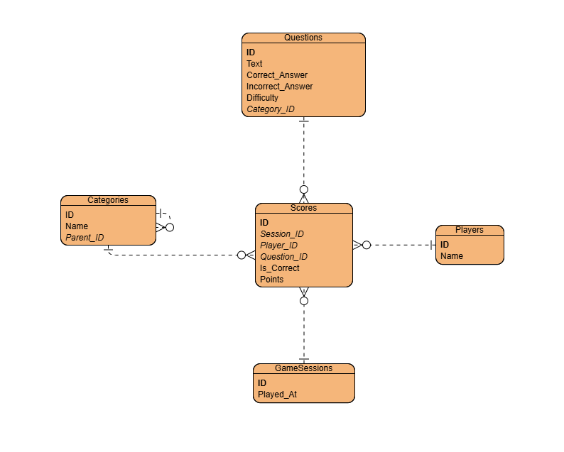
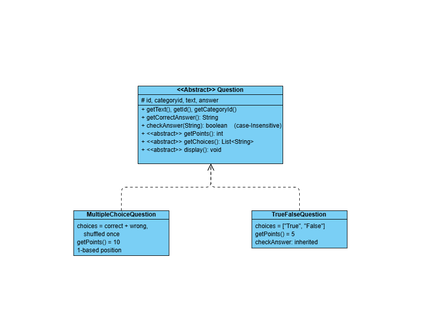
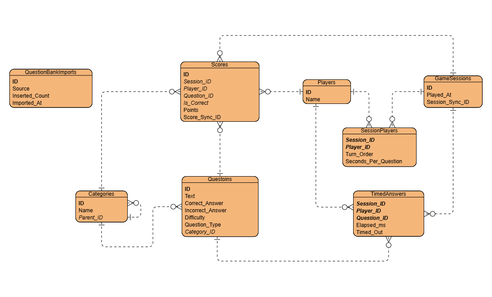

# CPE 314 — Software Design
**University of Cebu**  
**Computer Engineering Department**

## Trivia & Quiz Night Manager
### Project Design Document

### Table 1: Project Information

| Information | Details |
| :--- | :--- |
| **Group Name / No.:** | 2 |
| **Members:** | **John Daevin S. Simbajon** - (Team Lead + Integrator/DevOps)<br>**Clarence Philip A. Elegino** - (Core OOP/Logic Developer)<br>**Justine B. Cuizon** - (Database Admin + Data Developer + API)<br>**Joshua Neil G. Malaya** - (UI/UX Designer + JavaFX Developer)<br>**Gebrielle P. Mirasol** - (Analytics + QA) |
| **Instructor:** | Richyll Son |
| **Term:** | First Semester, S.Y. 2026-2027 |
| **Document Version / Date:** | V0.4 - 11/14/26 |

---

## Table of Contents
- [Revision History](#revision-history)
- [1. Introduction & Project Overview](#1-introduction--project-overview)
- [2. Preliminary ER Sketch & Team Roles](#2-preliminary-er-sketch--team-roles)
- [3. System Architecture & Object-Oriented Design](#3-system-architecture--object-oriented-design)
- [4. Data Model & Database Design](#4-data-model--database-design)
- [5. API Integration Design](#5-api-integration-design)
- [6. Concurrency Design](#6-concurrency-design)

----
### Table 2: Revision History

## Revision History

| Version | Date | Authors | Changes |
| :--- | :--- | :--- | :--- |
| **0.1** | 10/24/26 - 10/26/26 | Justine Cuizon, Clarence Philip Elegino, Joshua Malaya, Gebrielle Mirasol, John Daevin Simbajon | Initial draft. <br> Section 1 to 2 added. <br> Removing Unnecessary Instruction. Generating the Table of Contents. |
| **0.2** | 10/28/26 | John Daevin Simbajon | Section's 3 and 4 added. |
| **0.3** | 11/05/26<br>11/06/26 | Gebrielle Mirasol<br>John Daevin Simbajon | Sections 5 and 6 added. <br> Sections 1, 2, 3 and 4 revised to match the implemented code: real package and class names, real database schema, JSON score import instead of CSV, corrected team roles table. <br> Revised One-Paragraph Pitch |
| **0.4** | 11/12/26<br>11/13/26<br>11/14/26 | John Daevin S. Simbajon<br> Clarence Philip A. Elegino | Revised ER sketches, Section 1 pitch, database schema and Table 5 (Section 4), API request and response (Section 5), background operations (Section 6) and tables used for analytics (Section 7). Section 8,9 and appendix added.  |

| **1.0** | *Pending* | Group 2 | Final compilation and polish — Week 11. |

----

## 1. Introduction & Project Overview

**Trivia & Quiz Game Night Manager** is a Java desktop application, built with JavaFX and SQLite, that helps friends, classmates, and community groups run trivia nights. A host adds players and starts a timed, turn-based round-robin game, and each player answers multiple-choice or true/false questions with an option to undo the last answer. Questions come from a local offline question bank that can be extended by downloading more from the Open Trivia Database, filtered by difficulty and question type, or by importing a JSON file. Every player, game session, answer, and score is saved in the database, and past scores can be exported to and imported from JSON without creating duplicates. The app then analyzes the saved results and shows accuracy by category and points per game as labeled bar and line charts.

- **Theme:** Custom idea (an entertainment and social-gaming tool for trivia nights).
- **Problem solved:** Quiz hosts usually keep score on paper or in scattered spreadsheets, so results are easy to lose and hard to compare from one night to the next.
- **Key value proposition:** One app that fetches questions, scores each player, stores the history, and turns it into clear charts, so groups can see who is improving and which categories are hardest.
- **Planned:** user accounts with host and player roles, so each player can sign in and see their own scores.

---

## 2. Preliminary ER Sketch & Team Roles

### Preliminary ER Sketch
*(Figure 1: Entities, key attributes and relationships — preliminary sketch from version 0.1, 10/26/26, superseded by Figure 3 in Section 4)*



### Table 3: Team members and primary roles
| Member | Primary Role |
| :--- | :--- |
| **John Daevin S. Simbajon** | Team Lead + Integrator/DevOps |
| **Clarence Philip A. Elegino** | Core OOP/Logic Developer |
| **Justine B. Cuizon** | Database Admin + Data Developer + API |
| **Joshua Neil G. Malaya** | UI/UX Designer + JavaFX Developer |
| **Gebrielle P. Mirasol** | Analytics + QA |

---

## 3. System Architecture & Object-Oriented Design

### Class Hierarchy
*(Figure 2: Class hierarchy)*



The GUI and `GameEngine` only ever hold a `Question`. Each question type decides its own points, answer choices, and answer checking, so adding a new type (for example a numeric-answer question) means adding one subclass and one case in `QuestionMapper`, with no change to the game or the screens.

### Supporting Classes by Package

All packages are under `com.triviagame`.

- `questions`: Question, MultipleChoiceQuestion, TrueFalseQuestion, QuestionMapper
- `category`: Category
- `db`: Database, PlayerDao, CategoryDao, QuestionDao, ScoreDao, AnalyticsDao, SampleQuestionSeeder, ScoreJsonImporter, QuestionBankService, SessionPlayerDao, TimedAnswerDao
- `api`: OpenTdbClient, QuestionParser, BankQuestion
- `tasks`: FetchQuestionsTask, JsonImportTask
- `gameplay`: GameEngine, NewGameScreen, GameScreen
- `m2`: RoundRobinGame, M2GameScreen, M2DemoApp, M2Launcher
- `analytics`: AnalyticsScreen
- `results`: Results
- `importer`: ImportScreen
- `players`: Players
- `home`: Home, Navigator, Ui
- Root package: App, Main

### Table 4 : How Each Class Follows the Single Responsibility Principle

| Class or Component | Responsibility |
| :--- | :--- |
| Question and subclasses | Represent questions, scoring rules, and answer choices |
| QuestionMapper | Convert stored questions into the appropriate Question subclass |
| Category | Provide hierarchical category searching through recursion |
| Database | Establish SQLite connections and initialize the schema |
| DAO classes | Handle SQLite operations using PreparedStatement |
| GameEngine | Manage question ordering, scores, and Undo |
| OpenTdbClient | Send HTTP requests to OpenTDB |
| QuestionParser | Parse and validate JSON question data |
| BankQuestion | Represent imported question data |
| QuestionBankService | Save questions and skip duplicates |
| FetchQuestionsTask | Download trivia questions using a background task |
| JsonImportTask | Import questions from local JSON files |
| ScoreJsonImporter | Import historical scores asynchronously |
| AnalyticsDao | Perform analytical database queries |
| M2GameScreen | Display the separate M2 multiplayer game interface |
| RoundRobinGame | Manage multiplayer turns and scoring |
| Home and Navigator | Handle navigation between application screens |

### Design Rationale

The application follows a layered architecture separating question models, game logic, database operations, API integration, background processing, and JavaFX interfaces.

The primary JavaFX application starts from App, initializes SQLite, and displays Home.

NewGameScreen creates and configures GameEngine, while GameScreen presents questions and handles player input.

GameEngine uses a Queue for question ordering and maintains an Undo history. ScoreDao handles database score persistence.

Database stores application records in data/trivia.db. It creates the data directory when necessary and enables SQLite foreign-key enforcement.

OpenTdbClient uses Java HttpClient to request trivia questions. QuestionParser converts the JSON response into BankQuestion records.

QuestionBankService stores questions in SQLite and skips duplicates.

FetchQuestionsTask and JsonImportTask perform question operations outside the JavaFX application thread.

The separate M2 package provides a local multiplayer demonstration through RoundRobinGame and M2GameScreen. Integration with the primary Home navigation remains pending.

JUnit 5 tests cover game logic, database access, recursion, question parsing, and edge cases.

---

## 4. Data Model & Database Design

### Finalized ER Diagram
*(Figure 3: Finalized ER diagram)*



### Table 5: Relationship and Cardinality
| Relationship | Cardinality | Foreign Key | Meaning |
| :--- | :--- | :--- | :--- |
| **categories $\rightarrow$ categories** | 1:M | `categories.parent_id` | A category has many subcategories (`NULL` = top level) |
| **categories $\rightarrow$ questions** | 1:M | `questions.category_id` | A category contains many questions; each question has exactly one category |
| **questions $\rightarrow$ scores** | 1:M | `scores.question_id` | A question can be answered in many score rows; a score's category is found through its question |
| **players $\rightarrow$ scores** | 1:M | `scores.player_id` | A player has many score rows |
| **game_sessions $\rightarrow$ scores** | 1:M | `scores.session_id` | A session has many score rows |
| **players $\leftrightarrow$ game_sessions** | M:N | Resolved by `session_players` | A player joins many sessions, and a session has many players |
| **game_sessions $\rightarrow$ session_players** | 1:M | `session_players.session_id` | A session lists all of its players |
| **players $\rightarrow$ session_players** | 1:M | `session_players.player_id` | A player appears in every session they join, with a turn order |
| **game_sessions $\rightarrow$ timed_answers** | 1:M | `timed_answers.session_id` | A session has many timed answers |
| **players $\rightarrow$ timed_answers** | 1:M | `timed_answers.player_id` | A player has one timing record for each question they answer |
| **questions $\rightarrow$ timed_answers** | 1:M | `timed_answers.question_id` | A question can be timed for many players and sessions |
| **question_bank_imports** | none | none | A standalone log of question imports; it has no foreign keys |

---

### SQLite Schema
These are the statements that create the database. Database.initializeSchema() creates the first five tables and adds the sync-ID columns, indexes and triggers. 
SessionPlayerDao, TimedAnswerDao and QuestionBankService each create one of the remaining three tables.

```sql
PRAGMA foreign_keys = ON;   -- run on every connection

-- Created by Database.initializeSchema()
CREATE TABLE IF NOT EXISTS categories (
    id        INTEGER PRIMARY KEY AUTOINCREMENT,
    name      TEXT NOT NULL,
    parent_id INTEGER REFERENCES categories(id)
);

CREATE TABLE IF NOT EXISTS players (
    id   INTEGER PRIMARY KEY AUTOINCREMENT,
    name TEXT NOT NULL
);

CREATE TABLE IF NOT EXISTS game_sessions (
    id              INTEGER PRIMARY KEY AUTOINCREMENT,
    played_at       TEXT NOT NULL DEFAULT CURRENT_TIMESTAMP,
    session_sync_id TEXT                 -- added by migration
);

CREATE TABLE IF NOT EXISTS questions (
    id                INTEGER PRIMARY KEY AUTOINCREMENT,
    text              TEXT NOT NULL,
    correct_answer    TEXT NOT NULL,
    incorrect_answers TEXT NOT NULL,     -- JSON array of strings
    difficulty        TEXT NOT NULL,
    question_type     TEXT NOT NULL DEFAULT 'MULTIPLE_CHOICE',
    category_id       INTEGER NOT NULL REFERENCES categories(id)
);

CREATE TABLE IF NOT EXISTS scores (
    id            INTEGER PRIMARY KEY AUTOINCREMENT,
    session_id    INTEGER NOT NULL REFERENCES game_sessions(id),
    player_id     INTEGER NOT NULL REFERENCES players(id),
    question_id   INTEGER NOT NULL REFERENCES questions(id),
    is_correct    INTEGER NOT NULL CHECK (is_correct IN (0, 1)),
    points        INTEGER NOT NULL,
    score_sync_id TEXT                   -- added by migration
);

CREATE UNIQUE INDEX IF NOT EXISTS ux_game_sessions_session_sync_id
    ON game_sessions(session_sync_id);
CREATE UNIQUE INDEX IF NOT EXISTS ux_scores_score_sync_id
    ON scores(score_sync_id);

-- Give every new row a permanent random ID
CREATE TRIGGER IF NOT EXISTS trg_session_sync_id
AFTER INSERT ON game_sessions
WHEN NEW.session_sync_id IS NULL OR NEW.session_sync_id = ''
BEGIN
    UPDATE game_sessions
    SET session_sync_id = lower(hex(randomblob(16)))
    WHERE id = NEW.id;
END;

CREATE TRIGGER IF NOT EXISTS trg_score_sync_id
AFTER INSERT ON scores
WHEN NEW.score_sync_id IS NULL OR NEW.score_sync_id = ''
BEGIN
    UPDATE scores
    SET score_sync_id = lower(hex(randomblob(16)))
    WHERE id = NEW.id;
END;

-- Created by SessionPlayerDao
CREATE TABLE IF NOT EXISTS session_players (
    session_id           INTEGER NOT NULL REFERENCES game_sessions(id),
    player_id            INTEGER NOT NULL REFERENCES players(id),
    turn_order           INTEGER NOT NULL CHECK (turn_order > 0),
    seconds_per_question INTEGER NOT NULL
                         CHECK (seconds_per_question BETWEEN 5 AND 300),
    PRIMARY KEY (session_id, player_id),
    UNIQUE (session_id, turn_order)
);

-- Created by TimedAnswerDao
CREATE TABLE IF NOT EXISTS timed_answers (
    session_id  INTEGER NOT NULL REFERENCES game_sessions(id),
    player_id   INTEGER NOT NULL REFERENCES players(id),
    question_id INTEGER NOT NULL REFERENCES questions(id),
    elapsed_ms  INTEGER NOT NULL CHECK (elapsed_ms >= 0),
    timed_out   INTEGER NOT NULL CHECK (timed_out IN (0, 1)),
    PRIMARY KEY (session_id, player_id, question_id)
);

-- Created by QuestionBankService
CREATE TABLE IF NOT EXISTS question_bank_imports (
    id             INTEGER PRIMARY KEY AUTOINCREMENT,
    source         TEXT NOT NULL,
    inserted_count INTEGER NOT NULL,
    imported_at    TEXT NOT NULL DEFAULT CURRENT_TIMESTAMP
);
```

### Design Notes
- `incorrect_answers` stores the wrong options as a JSON array, for example `["Earth","Venus","Jupiter"]`. It is read back with Jackson, so answers that contain commas or quotes survive. Storing them in one column keeps the model simple. A separate `answer_option` table would be the fully normalized alternative.
- `question_type` (`MULTIPLE_CHOICE` or `TRUE_FALSE`) tells `QuestionMapper` which `Question` subclass to build. `initializeSchema()` adds the column to older database files that lack it.
- CHECK constraints keep is_correct and timed_out at 0 or 1, turn_order above 0, seconds_per_question between 5 and 300, and elapsed_ms at 0 or more.
- Duplicate questions are prevented through `QuestionBankService.importQuestions()`. The service normalizes category names and question text, checks existing SQLite records, and skips duplicate questions during import. Duplicate prevention is implemented in application code rather than through a `UNIQUE` database constraint.
- Every SQL statement in the DAO classes uses `PreparedStatement`, and `Database` turns on `PRAGMA foreign_keys` for each connection, since SQLite does not enforce foreign keys by default.
- Deleting a player who already has scores is blocked by the foreign key, and the Players screen shows a friendly message instead of the raw error.
- `session_players` records which players take part in a session. It is the link table that resolves the many-to-many relationship between `players` and `game_sessions`, and it stores each player's `turn_order` and `seconds_per_question`. Its composite primary key `(session_id, player_id)` stops a player from joining the same session twice, and `UNIQUE (session_id, turn_order)` gives every player in a session a different turn.
- `timed_answers` stores how long each player took on each question (`elapsed_ms`) and whether the timer ran out (`timed_out`). Its composite key `(session_id, player_id, question_id)` allows one timing record per player per question. The multiplayer game reads it to rank players and break ties on the leaderboard.
- A score does not store a category. Its category is found through scores.question_id → questions.category_id, so the category is stored only once and cannot disagree with the question.
- `question_bank_imports` is a standalone log with no foreign keys. It records the source of each question import (such as the API download or a JSON file) and how many questions were inserted, so the application can tell whether a source has already been loaded.
- `session_sync_id` and `score_sync_id` are permanent random IDs for sessions and scores. Database triggers create them for every new row, and unique indexes prevent repeats. The JSON export writes both IDs, and the import uses them to skip scores it has already stored, so importing the same file twice does not duplicate data. Older JSON files without these IDs cannot be reliably deduplicated. For existing databases, `initializeSchema()` adds both columns and fills them in for old rows.
- The schema has few `UNIQUE` constraints. Duplicate questions are prevented in application code (see above), but the database does enforce uniqueness on the two sync-ID columns and on `(session_id, turn_order)` in `session_players`.
- `Database.initializeSchema()` creates the first five tables, the sync columns, the indexes and the triggers. `session_players`, `timed_answers` and `question_bank_imports` are created by `SessionPlayerDao`, `TimedAnswerDao` and `QuestionBankService`, each running its own `CREATE TABLE IF NOT EXISTS`.


---


## 5. API Integration Design

### Public API

The application uses the Open Trivia Database (OpenTDB), a public trivia API that does not require an API key.

The API is an optional source for downloading additional questions. Normal gameplay uses locally stored questions, supporting offline operation.

### Actual API Classes

| Class | Responsibility |
| :--- | :--- |
| `OpenTdbClient` | Sends HTTP requests to OpenTDB |
| `QuestionParser` | Parses JSON responses and validates question data |
| `BankQuestion` | Represents an imported question |
| `FetchQuestionsTask` | Fetches and imports questions on a background JavaFX task |
| `JsonImportTask` | Imports trivia questions from a local JSON file |
| `QuestionBankService` | Saves questions to SQLite and skips duplicates |

### Endpoint

The current application requests:

`GET https://opentdb.com/api.php?amount=10&encode=url3986`

### Endpoint

The application sends a `GET` request to `https://opentdb.com/api.php`. The `amount` and `encode` parameters are always sent. `difficulty` and `type` are added only when the user selects a specific value:

`https://opentdb.com/api.php?amount=10&encode=url3986`

`https://opentdb.com/api.php?amount=10&encode=url3986&difficulty=easy&type=boolean`

### Table 6: API Request Parameters

| Parameter | Current implementation | Purpose |
| :--- | :--- | :--- |
| `amount` | Always sent; 1 to 50 (other values are rejected) | Number of questions requested |
| `encode` | Always sent; `url3986` | Percent-encodes question and answer text |
| `difficulty` | Sent only if not "any": `easy`, `medium` or `hard` | Filters questions by difficulty |
| `type` | Sent only if not "any": `multiple` or `boolean` | Filters by multiple-choice or true/false |
| `category` | Not sent | Categories come from each downloaded question, not from a request filter |

### Response Format

OpenTDB returns a JSON object. `response_code` is 0 on success, and `results` is a list of questions. Because the request uses `encode=url3986`, the text values arrive percent-encoded and are decoded by `QuestionParser`.

{
  "response_code": 0,
  "results": [
    {
      "category": "Science%3A%20Computers",
      "type": "multiple",
      "difficulty": "easy",
      "question": "…",
      "correct_answer": "…",
      "incorrect_answers": ["…", "…", "…"]
    }
  ]
}

| Field | Type | How it is used |
| :--- | :--- | :--- |
| `response_code` | number | Any value other than 0 is treated as an error |
| `category` | text | Used to find or create a category |
| `type` | `multiple` or `boolean` | Mapped to `MULTIPLE_CHOICE` or `TRUE_FALSE` |
| `difficulty` | text | Stored with the question |
| `question` | text | Question text, decoded |
| `correct_answer` | text | The correct answer |
| `incorrect_answers` | list of text | Stored as a JSON array |

### Multiple-Choice Answer Limitations

OpenTDB returns one correct answer and three incorrect answers for a standard multiple-choice question.

Therefore, each multiple-choice question normally has four answer options.

The number of answer choices cannot be configured through the OpenTDB API.

True/False questions contain two choices: True and False.

The application's MultipleChoiceQuestion class can display a variable number of choices, allowing appropriately formatted imported questions to use different answer counts.

The download amount is separate from the answer count.

### Response Processing

1. OpenTdbClient sends an HTTP GET request using Java HttpClient.

2. The response is passed to QuestionParser.

3. QuestionParser uses Jackson to parse the JSON response, verifies the response code, decodes question text, and validates each question.

4. Multiple-choice questions are mapped to MULTIPLE_CHOICE, while boolean questions are mapped to TRUE_FALSE.

5. Parsed questions are represented by BankQuestion records.

6. FetchQuestionsTask passes downloaded questions to QuestionBankService.

7. QuestionBankService finds or creates categories, checks for duplicate questions, and saves new questions through QuestionDao.

8. Questions are stored in SQLite and can be reused for offline gameplay.

### Table 7: API Error Handling

| Situation | Current handling |
| :--- | :--- |
| Invalid download amount | IllegalArgumentException |
| HTTP status other than 200 | IOException with HTTP status |
| Invalid OpenTDB response code | IOException from QuestionParser |
| Malformed or incomplete JSON | Parsing exception |
| Network failure or timeout | Exception reported by the background task |
| Duplicate question | Skipped by QuestionBankService |
|invalid difficulty or type|IllegalArgumentException|
|zero questions returned|IOException “No questions match the selected filters”|
|non-zero response_code|IOException|
| `QuestionParser` | Parses and validates question JSON in two layouts: the OpenTDB response (`response_code` and `results`) and the application's own question-bank file (a `questions` list using `text`, `correctAnswer`, `incorrectAnswers` and `questionType`). Decodes percent-encoded and HTML-encoded text. |

The same parser reads local question files, which use a different layout, so the OpenTDB request and the offline question bank share one parsing and validation path.<br>
Screens that start a download show the result or the error in a status label. A failed request leaves the questions already stored untouched, so the offline question bank stays available.

### Background Processing

`FetchQuestionsTask` extends JavaFX `Task`. It performs the network request and the SQLite import outside the JavaFX application thread, so the window stays responsive. It is started from two places:

- `Home` starts it with the amount, difficulty and question type chosen on the dashboard. The controls are disabled while the download runs, and a status label reports the result or the error.
- `M2GameScreen` starts it with the amount only, either as an automatic preload or when the user refreshes.

`JsonImportTask` also runs in the background to read and save a local JSON question file. It is started only from `M2GameScreen`.

Download failures, such as no matching questions, a non-zero OpenTDB response code, a timeout, or no network, are reported in the status label and do not change the questions already stored.

---

## 6. Concurrency Design

The application performs potentially slow HTTP requests and JSON imports on background threads to keep the JavaFX interface responsive.

### Table 8: Background Operations

| Operation | Started from | Background processing | UI update |
| :--- | :--- | :--- | :--- |
| Download trivia questions | `Home` and `M2GameScreen` | `FetchQuestionsTask` (JavaFX `Task`) on a daemon thread | `setOnSucceeded`, `setOnFailed`, `setOnCancelled` |
| Import local trivia questions | `M2GameScreen` | `JsonImportTask` (JavaFX `Task`) on a daemon thread | `setOnSucceeded`, `setOnFailed` |
| Import historical scores | `ImportScreen` | `ScoreJsonImporter.importAsync` (`CompletableFuture` on a single-thread executor) | `whenComplete` + `Platform.runLater` |
| Export historical scores | `ImportScreen` | `Task` calling `ScoreJsonExporter` on a daemon thread | `setOnSucceeded`, `setOnFailed` |

### API Download Process

1. The user requests additional questions in M2GameScreen.
2. M2GameScreen starts FetchQuestionsTask.
3. FetchQuestionsTask calls OpenTdbClient.
4. OpenTdbClient sends an HTTP request to OpenTDB.
5. QuestionParser validates and parses the returned JSON.
6. QuestionBankService checks for duplicates and saves new questions to SQLite.
7. JavaFX Task handlers display the result or error.

Downloaded questions remain available for offline gameplay.

### JSON Question Import Process

1. The user requests more questions on the Home dashboard or in M2GameScreen
2. MThe screen starts FetchQuestionsTask, passing the amount, and from Home also the difficulty and type.
3. QuestionParser reads and validates the questions.
4. QuestionBankService saves new questions to SQLite.
5. The JavaFX interface displays the import result.

### Historical Score Import

ScoreJsonImporter uses CompletableFuture with a single-thread executor.

ImportScreen receives completion results through whenComplete and Platform.runLater.

This allows large JSON score imports to run without blocking the JavaFX application thread.

Exporting scores runs ScoreJsonExporter in a JavaFX Task on a daemon thread, so writing a large file does not freeze the window.


### Thread Safety and UI Responsiveness

Network requests, JSON imports and exports run outside the JavaFX application thread. Controls are updated only on the application thread, through `Task` handlers or `Platform.runLater`.

While a task runs, its buttons are disabled and re-enabled when it finishes: the download controls on `Home`, the fetch and import buttons in `M2GameScreen`, and the choose, import and export buttons in `ImportScreen`. This also prevents two downloads from running at once.

All worker threads are daemon threads, so they do not keep the application open after the window closes.

### Verification

- Unit tests cover `QuestionParser` and the score import (duplicate and invalid entries), and `GameEngineDatabaseTest` and `ScoreJsonImporterTest` check the database side.
- Manual check: <what you did, e.g. started a 50-question download and confirmed the window stayed responsive and the buttons were disabled until it finished>.
- Manual check: <e.g. turned off the network, started a download, and confirmed the error message appeared and the stored questions were still available>.

## 7. Data Mining & Visualization Design

The Trivia & Quiz Night Manager uses data mining and visualization to analyze players' performance based on their saved game results.

The application retrieves actual data from its SQLite database, performs SQL aggregation, and presents the results through JavaFX charts.

### 7.2 Data Mining and Aggregation

The `AnalyticsDao.java` class performs data analysis using SQL queries.

The following database tables are used:

* `scores` — stores players' answers, correctness, and earned points.
* `players` — stores player information.
* `categories` — identifies the category of each question.
* `game_sessions` — identifies individual game sessions.
* `questions`— links each score to its category.

The application uses SQL operations such as `COUNT()`, `SUM()`, `AVG()`, and `GROUP BY` to calculate performance statistics.

#### Category Accuracy

The application calculates the percentage of correct answers for each category.

Accuracy is calculated using:

Accuracy (%) = (Correct Answers / Total Answers) × 100

For example, if players answer 8 out of 10 Science questions correctly:

Accuracy = (8 / 10) × 100 = 80%

The result is calculated using the actual saved answers rather than hard-coded values.

Each saved answer is joined to its question to find the category, so the category is stored in one place only.

#### Points per Game

The application also calculates the total points earned by an individual player during each game session.

The `getPointsPerSession()` method groups scores by game session and calculates their totals using `SUM(points)`.

These results allow users to compare a player's performance across multiple games.

### 7.3 Data Visualization

The application uses the JavaFX chart components implemented in `AnalyticsScreen.java`.

#### Bar Chart — Accuracy by Category

The bar chart displays the percentage of correct answers for each trivia category.

* X-axis: Category
* Y-axis: Accuracy (%)
* Data source: `AnalyticsDao.getAccuracyByCategory()`

A bar chart was selected because it makes it easy to compare accuracy percentages across different categories and identify which topics players find easiest or most difficult.

#### Line Chart — Points per Game

The line chart shows a selected player's total points across saved game sessions.

* X-axis: Game session (date played)
* Y-axis: Points earned
* Data source: `AnalyticsDao.getPointsPerSession()`

A line chart was selected because it allows users to observe changes in player performance across successive game sessions.

### 7.4 Dynamic Data Updates

The charts are generated using actual data stored in SQLite.

When a game is completed or new scores are successfully imported, the database contains additional score records.

The user can open the Analytics screen or click Refresh to recalculate the statistics and update the charts.

For example, if a category originally contains 8 correct answers out of 10 attempts, its accuracy is 80%.

If two additional incorrect answers are saved, its accuracy becomes approximately 66.67%.

This demonstrates that changes in the underlying database affect both the calculated results and the visualizations.

### 7.5 Implementation and Design Rationale

| Component         | Java Class               | Responsibility                                       |
| ----------------- | ------------------------ | ---------------------------------------------------- |
| Database          | `Database.java`          | Provides SQLite database connections                 |
| Data Mining       | `AnalyticsDao.java`      | Performs SQL aggregation and analysis                |
| Visualization     | `AnalyticsScreen.java`   | Displays bar and line charts using JavaFX            |
| Score Persistence | `ScoreDao.java`          | Saves player scores used in analytics                |
| JSON Import       | `ScoreJsonImporter.java` | Adds imported scores that can contribute to analysis |

The design separates the data-processing layer from the presentation layer.

`AnalyticsDao` handles database queries and calculations, while `AnalyticsScreen` handles chart rendering and user interaction.

This separation follows the Single Responsibility Principle and allows the visualization interface to be modified without rewriting the SQL analysis logic
# 8. Testing Summary

The project is tested with JUnit 5 (`junit-jupiter` 5.11.4) and run through Maven. The suite has 16 test classes and 116 test methods in `src/test/java`. The tests cover the question classes, the game engine, the SQLite data access layer, the question parser, the question and score imports, and the analytics queries. Table 11 lists every test class with an edge case that it checks.

```bash
mvn test
```

**Table 11: JUnit test classes and key edge cases**

| Test class | Tests | What it covers | Edge cases checked |
| :--- | :--- | :--- | :--- |
| `GameEngineTest` | 19 | Scoring for multiple-choice and true/false questions, question queue order, undo, polymorphism, recursive category | Submitting on an empty queue returns `false`; loading a `null` list throws; blank and `null` answers score zero |
| `GameEngineDatabaseTest` | 7 | Saving every answer to the database; undo deletes the saved score | Answering after the last question saves nothing; a question without a database ID is rejected; practice games never touch the database |
| `MultipleChoiceQuestionTest` | 10 | Answer checking by text or by position; the list of choices | Out-of-range positions are wrong; `null` and blank input are wrong; the choices list cannot be modified |
| `TrueFalseQuestionTest` | 7 | True/false answer checking; fixed choices | A `null` correct answer never matches; invalid input is wrong |
| `CategoryTest` | 5 | In-memory category tree: find at any depth, collect all questions | A missing category returns `null`; an empty category returns an empty list |
| `PlayerSetupTest` | 3 | Validation of a player's name and seconds per question | An empty name and invalid seconds are rejected |
| `DatabaseTest` | 4 | Connection, database file creation, table creation, player insert and select | The database file is created on the first connection |
| `CategoryDaoTest` | 4 | Insert, select and subcategories | An invalid category name and a nonexistent category |
| `PlayerDaoTest` | 2 | Insert, select and delete a player | An empty player name is rejected |
| `QuestionDaoTest` | 3 | Question create, read, update and delete | An invalid question and a nonexistent question ID |
| `ScoreDaoTest` | 4 | Score create, read, update and delete | Invalid input is rejected; foreign-key protection blocks scores that reference missing rows |
| `QuestionParserTest` | 12 | Parsing OpenTDB responses and the question-bank file; URL and HTML decoding | Rate-limit and no-results response codes are rejected; an unknown question type; a broken answer list; double-encoded text |
| `QuestionImportTest` | 8 | Saving imported questions, duplicate handling, database migration | Duplicates inside one batch are counted once; concurrent imports create no duplicates; an SQL error rolls back the whole import |
| `ScoreJsonImporterTest` | 10 | Score JSON import, player reuse, asynchronous import | An empty array, malformed JSON, a top-level value that is not an array, a wrong field type, a missing file and a `null` file; invalid entries are skipped |
| `AnalyticsDaoTest` | 9 | Accuracy by category, top players, average points, points per session | A category without scores is omitted; an invalid top-players limit; a player without scores; an invalid player ID |
| `AnalyticsInsightsTest` | 9 | Best category per player, average points, games played | Ties go to the category with more answers; a full tie goes to the first name; a player with only wrong answers; answers from one session count as one game |
| **Total** | **116** | | |

The counts in Table 11 are test methods. One test in `QuestionParserTest` is parameterized and runs once for each HTML entity case, so the number of executed cases that Maven reports is slightly higher.

**Not yet covered.** There are no automated tests for `OpenTdbClient` (request URL, timeouts, HTTP status), for `FetchQuestionsTask` and `JsonImportTask`, for `RoundRobinGame`, or for the JavaFX screens. These gaps are listed in `KNOWN_ISSUES.md`. The planned tests use a fake HTTP response for the client and run each background task directly.

---

# 9. Individual Contributions

Each member's work can be checked in the git history of the repository <https://github.com/daevinsimbajon-web/cpe314-69167-capstone-team-02>. Table 12 gives the commit counts as of 14 November 2026, and Table 13 lists what each member built, the files where their code remains, and example commits.

```bash
git shortlog -sn --no-merges project/milestone-2
git log --author="<name>" --oneline project/milestone-2
git blame <file>
```

**Table 12: Team members, roles and commit counts **

| Member | Role | Git author name | Commits |
| :--- | :--- | :--- | :--- |
| John Daevin S. Simbajon | Team Lead + Integrator/DevOps | `daevinsimbajon-web`; `John Daevin S. Simbajon` | 36 | 
| Clarence Philip A. Elegino | Core OOP/Logic Developer | `philipelegino` | 46 | 
| Justine B. Cuizon | Database Admin + Data Developer + API | `Justine Cuizon` | 30 | 
| Joshua Neil G. Malaya | UI/UX Designer + JavaFX Developer | `jmalaya7231-lgtm` | 30 |
| Gebrielle P. Mirasol | Analytics + QA | `gebriellemirasol` | 15 | 

**Table 13: What each member built or owned**

| Member | Built or owned | Main files (lines remaining) | Example commits |
| :--- | :--- | :--- | :--- |
| John Daevin S. Simbajon | Home dashboard (shared with Joshua), lives tracking in the New Game screen, `countPlayedSessions` in `ScoreDao` and the `ScoreDaoTest` fix. Merged the teammates' branches and owns the design document. | `home/Home.java` (115)<br>`gameplay/NewGameScreen.java` (36)<br>`db/ScoreDao.java` (23)<br>`doc/design-document.md` (255) | `52569e4` Refactor Home to use JavaFX<br>`860fbec` countPlayedSessions and ScoreDaoTest fix<br>`6fa80a5` Lives tracking in NewGameScreen |
| Clarence Philip A. Elegino | The question class hierarchy, the category tree, `GameEngine` (question queue, undo stack, scoring), `RoundRobinGame` (turn rules) and the console game. Wrote the unit tests for these classes and uploaded the design-document figures. | `gameplay/GameEngine.java` (162)<br>`m2/RoundRobinGame.java` (203)<br>`category/Category.java` (55)<br>`questions/MultipleChoiceQuestion.java` (68), `Question.java` (50), `TrueFalseQuestion.java` (31)<br>`Main.java` (166)<br>`GameEngineTest` (357), `CategoryTest` (116), `MultipleChoiceQuestionTest` (149), `TrueFalseQuestionTest` (96) | `156d205`, `18a888d`, `bcc6f78` Question and category tests<br>`3124ac5` GameEngine<br>`5b4b05e` Create RoundRobinGame |
| Justine B. Cuizon | The SQLite schema and all DAOs, the offline question bank, the OpenTDB client and parser, the background tasks, JSON export and the duplicate-safe sync IDs, and the multiplayer game screen. Wrote the tests for the database, the parser and the question import. | `db/Database.java` (215), `QuestionDao` (372), `ScoreDao` (345), `SessionPlayerDao` (250), `TimedAnswerDao` (174), `CategoryDao` (271), `PlayerDao` (150), `QuestionBankService` (253)<br>`api/OpenTdbClient.java` (121), `QuestionParser.java` (423)<br>`tasks/FetchQuestionsTask.java` (66), `JsonImportTask.java` (42)<br>`db/ScoreJsonExporter.java` (151), `ScoreJsonImporter.java` (463)<br>`m2/M2GameScreen.java` (876) | `6fc3bdc` Offline question bank and API filters<br>`706a5bd` Duplicate-safe JSON sync<br>`3253c2e` Reuse existing players in multiplayer sessions<br>`785578b` Question import and HTML decoding |
| Joshua Neil G. Malaya | The JavaFX screens: new game, players, results, analytics charts, score import and export, and the home dashboard, plus the shared UI helpers, icons and stylesheet. | `gameplay/NewGameScreen.java` (497)<br>`analytics/AnalyticsScreen.java` (271)<br>`importer/ImportScreen.java` (201)<br>`players/Players.java` (192)<br>`home/Home.java` (155)<br>`results/Results.java` (122)<br>`home/Ui.java` (66), `App.java` (59), `VectorIcons.java` (43) | `23e098f` Implement AnalyticsScreen<br>`9fbcbe8` Implement ImportScreen<br>`70ac878` Integrate multiplayer and API into Home<br>`d357f69` Redesign dashboard and add question filters |
| Gebrielle P. Mirasol | The analytics queries (`AnalyticsDao`), the first version of the score JSON importer, the sample score data and its generator, and the analytics, importer and game-engine database tests. Wrote the first drafts of design-document Sections 5 and 6. | `db/AnalyticsDao.java` (315)<br>`db/ScoreJsonImporter.java` (117)<br>`tools/generate_sample_scores.py` (63)<br>`AnalyticsDaoTest` (427), `AnalyticsInsightsTest` (303), `ScoreJsonImporterTest` (521), `GameEngineDatabaseTest` (209) | `5f24369` AnalyticsDao and AnalyticsDaoTest<br>`5722e44` AnalyticsInsightsTest<br>`4225434` GameEngineDatabaseTest<br>`c45aa39` sample_scores_2000 |

---

# Appendix

## A. Public API: Open Trivia Database (OpenTDB)

* **Website:** <https://opentdb.com>
* **API documentation:** <https://opentdb.com/api_config.php>
* **License:** All data provided by the API is licensed under the Creative Commons Attribution-ShareAlike 4.0 International License (CC BY-SA 4.0). The questions downloaded by the application come from OpenTDB.
* **Limits:** The API allows at most 50 questions per request and one request per IP address every 5 seconds.

**Table 14: OpenTDB response codes**

| `response_code` | Meaning | How the application treats it |
| :--- | :--- | :--- |
| `0` | Success | The questions are parsed and saved |
| `1` | No results: not enough questions for the query | Reported as an error; stored questions are unchanged |
| `2` | Invalid parameter | Reported as an error |
| `3` | Session token not found | Reported as an error (the application does not use session tokens) |
| `4` | Session token empty | Reported as an error (the application does not use session tokens) |
| `5` | Rate limit: one request per IP address every 5 seconds | Reported as an error; the user can try again later |

`QuestionParser` accepts only response code `0`, as described in Section 5. The request encoding is `url3986` (RFC 3986), which the parser decodes.

## B. Technologies and versions

**Table 15: Libraries and tools (from `pom.xml`)**

| Component | Version | Used for |
| :--- | :--- | :--- |
| Java (JDK) | 17 (release level) | Language and runtime |
| JavaFX (`javafx-controls`) | 21.0.6 | User interface and charts |
| SQLite JDBC (`sqlite-jdbc`) | 3.46.1.0 | Local database access |
| Jackson (`jackson-databind`) | 2.17.2 | JSON parsing and export |
| JUnit Jupiter | 5.11.4 | Automated tests |
| Maven Surefire plugin | 3.2.5 | Runs the tests |
| JavaFX Maven plugin | 0.0.8 | Starts the application (`mvn javafx:run`) |

## C. Build and run

The application needs JDK 17 and Maven. The SQLite database file is created at `data/trivia.db` on first start.

```bash
mvn compile        # build
mvn test           # run the automated tests
mvn javafx:run     # start the application (com.triviagame.App)
```

## D. Supplementary material in the repository

* **Sample data:** `sample-data/sample_scores_2000.json` holds 2,000 sample score records, and `sample_scores_change_demo.json` is a second sample file. Both use the score export format that the Import screen reads.
* **Generator:** `tools/generate_sample_scores.py` creates the sample score files.
* **Question bank:** `src/main/resources/example_question_bank.json` is an example of the question-bank file that the application can import.
* **Known issues:** `KNOWN_ISSUES.md` in the repository root lists the problems that remain and maps each requirement to the code that implements it.
